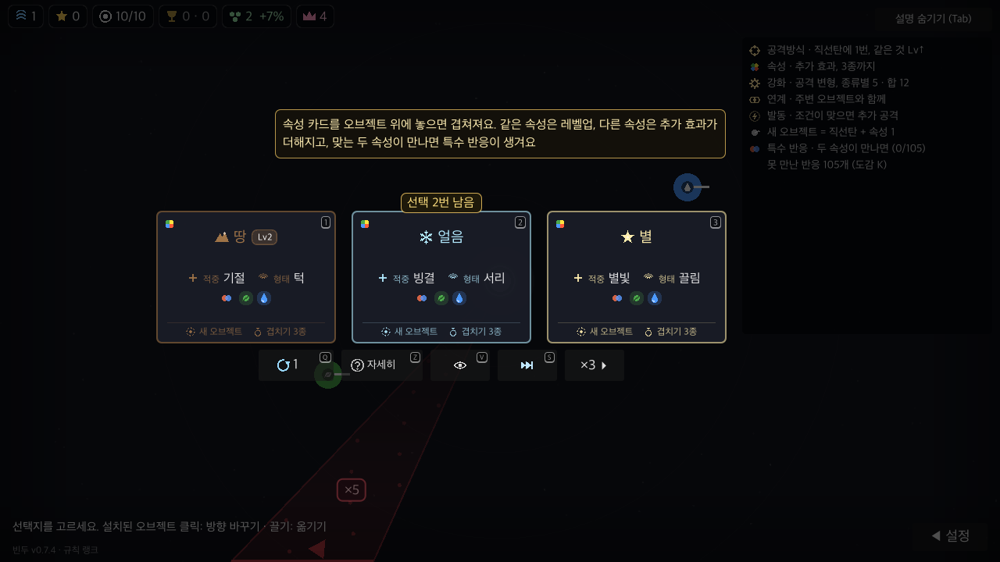
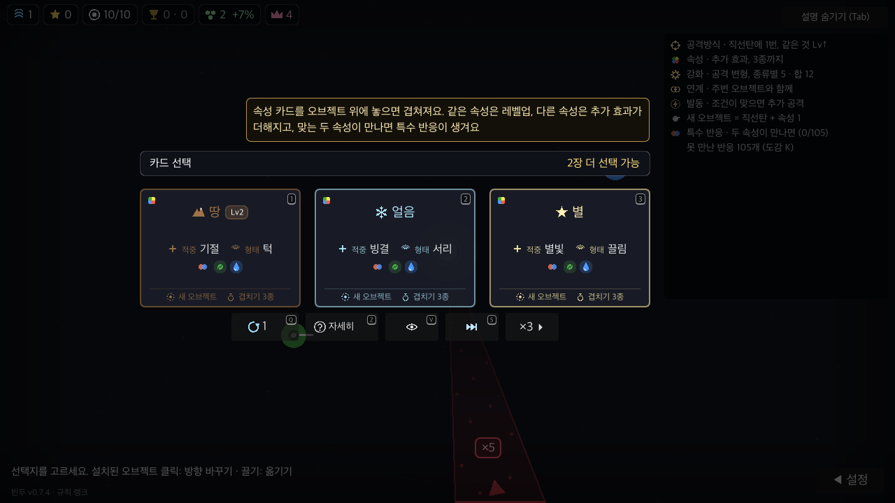
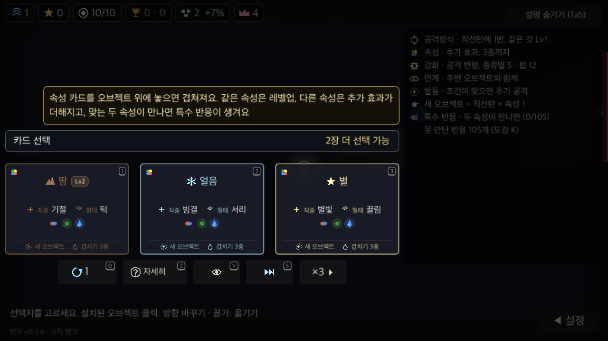
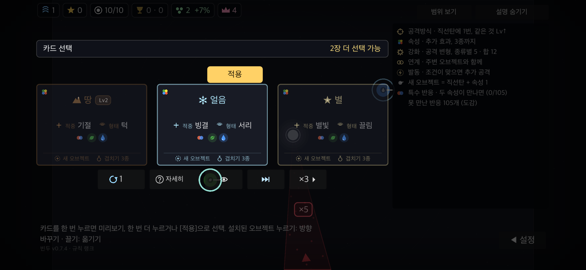

# 남은 카드 선택 안내 UI 검증

2026-11-02. 기준 main `0c8e15b`에서 분기한 `codex/fix-choice-count-layout`.
macOS arm64, Godot 4.7.2, Python 3.13.9. 개인 저장·온라인 기능을 분리한 프로젝트 사본에서 검사했다.

## 문제와 변경

기존 '선택 2번 남음' 배지는 가운데 카드 상단에 3 UI 단위 겹쳐 있어 해당 카드의 설명으로 보였다.
카드 줄 전체 폭의 독립 헤더에 '카드 선택'과 'N장 더 선택 가능'을 나눠 배치했다.
카드 위 간격은 18 UI 단위, 터치는 [적용] 버튼 자리 36을 더해 54다.
첫 판 안내·봉인 칩·DPS 표·자세히 창도 새 헤더 자리를 고려한다.

| 수정 전 | 수정 후 |
|---|---|
|  |  |

큰 글자 130%와 터치 가운데 카드 미리보기:




## 렌더링 검사

고정 카드(땅 Lv2·얼음·별), 남은 선택 2장·1장·12장, 두 줄 첫 판 안내, 봉인을 확인했다.
터치 프로필은 첫째·가운데·셋째 카드 미리보기 및 자세히 창을 추가했다.

| 프로필 | 창 해상도 요청 | 글자 크기 | 캡처 수 |
|---|---|---|---|
| 데스크톱 | 1280×720 | 100% | 5 |
| 큰 글자 | 1280×720 | 130% | 5 |
| 폰 안전 영역·터치 모의 | 2556×1179 | 130% | 9 |
| 태블릿 비율·터치 모의 | 2048×1536 | 130% | 9 |
| 넓은 화면 | 3440×1376 | 100% | 5 |

33개 모두 헤더 양끝과 실제 카드 줄 양끝 일치, 최소 간격 18, [적용]·첫 판 안내와 비교한 교차 검사 통과.
`ui_check.gd`의 `UI OVERLAP`·`UI OFFSCREEN`·`UI CLIP` 및 스크립트 오류 0개.
수정 전 같은 데스크톱 조건으로도 5개 화면을 캡처했다.

캡처한 `scripts/main.gd` SHA-256:
`015cf1ec542f67045955b36d20bc1e4491807e45617b94d6eca0decff860e777`.
게임 소스와 렌더링 사본의 해당 파일이 같은지 바이트 단위로 확인했다.

재실행 예(사본의 `config/name`을 `BinduToolsChoice`처럼 바꿔 개인 저장과 분리하고, 서버·멀티 주소를 비운 뒤 실행):

```sh
mkdir -p /tmp/bindu-choice-shots
GODOT=/tmp/bindu-hold-qa/Godot.app/Contents/MacOS/Godot
"$GODOT" --headless --path /path/to/isolated-copy --import
"$GODOT" --path /path/to/isolated-copy --resolution 1280x720 \
  --script docs/qa/2026-11-02-choice-count/capture.gd -- /tmp/bindu-choice-shots 1.0
```

큰 글자는 마지막 인자를 `1.3`, 폰은 해상도를 `2556x1179`, 마지막 인자를 `1.3 touch phone`으로 바꾼다.
원본 캡처·실행 로그: `/tmp/bindu-choice-pr-qa/`.

## 기능·종합 검사

- `GODOT=<Godot 4.7.2> tools/run.sh spec`: 종료 코드 0, 기능 174개 통과. UI-28은 남은 장수 2→1 갱신, 특성·필드 보기·카드 선택 후 헤더 숨김을 확인한다.
- `tools/run.sh check`: 기능·궤적·무작위 입력 4개 시드(오류 0)·13웨이브 이어하기·온라인·패치 키 적용·정원 검사 통과. 서버 테스트 `25 passed, 1 warning`.
- 전체 종료 코드 1: `CHECK 실패: rulekeys`. 기준 main 사본에서도 `VERIFY=1 tools/run.sh rulekeys`가 동일하게 실패했다: `server/app/rule_keys.json이 오래됨`. 이번 변경은 그 수치·생성 파일을 수정하지 않는다.
- `python3 tools/notes_check.py`: `NOTES ok`. 내장 패치노트 재생성은 최신 0.7.4·생성 파일 변경 없음.
- `git diff --check`: 종료 코드 0.

폰·태블릿은 Mac에서 화면비·글자 크기·터치 상태·안전 영역을 모의한 렌더링이다. 실제 모바일 기기 입력·스크린리더·배포본은 미검증이다.
