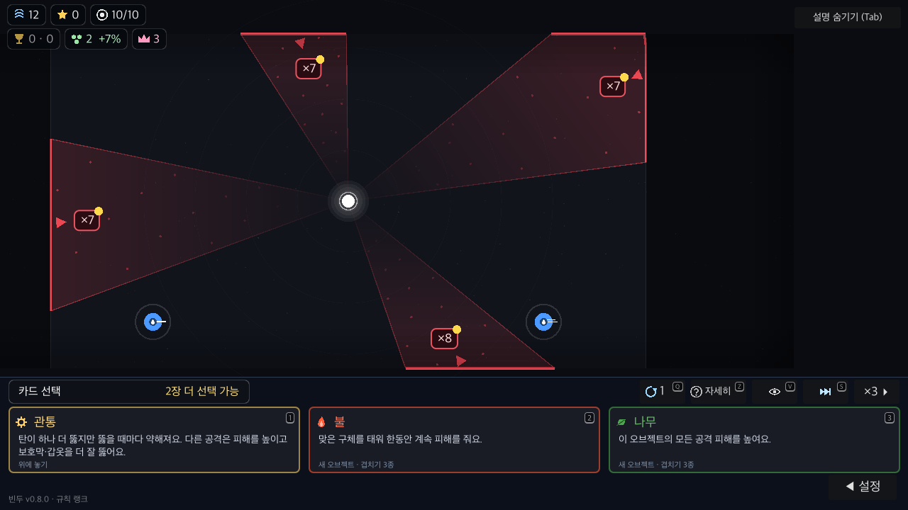
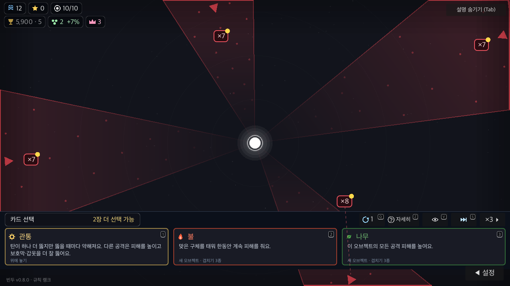
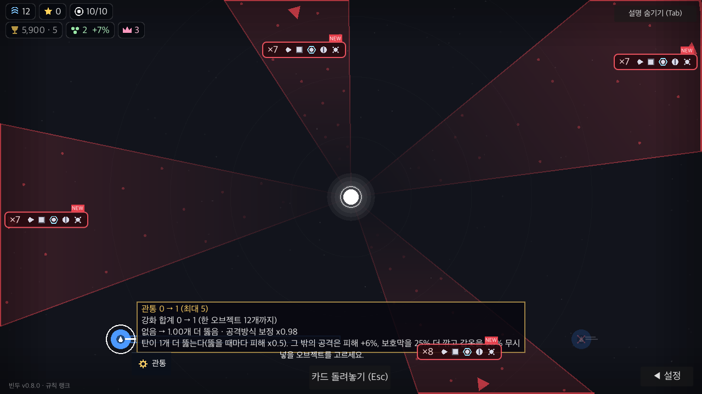
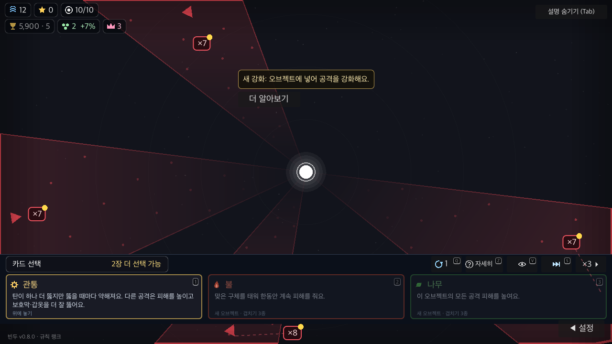
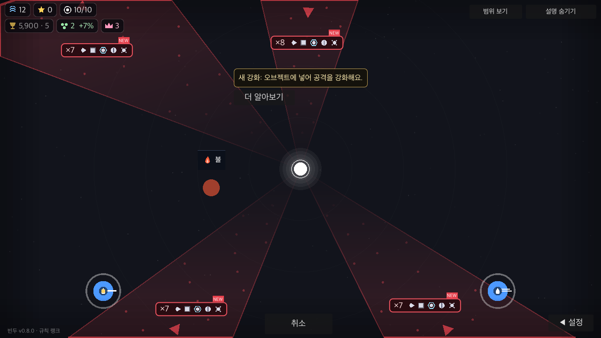
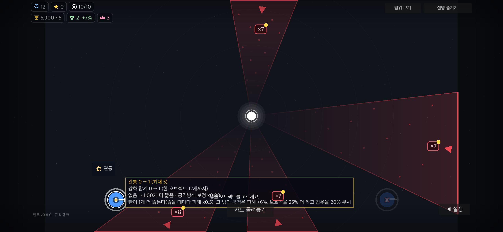

# PR #13 카드 들기 구현 검증

> 이후 결과: [2026-11-04 충돌 해결·전체 검사 재검증](../2026-11-04-pr13-checks/README.md). 아래 실패 기록은 6146a6e 당시의 이력이다.

2026-11-03. 기존 PR head `dc7366c` 위에서 구현했다. 대상 브랜치는 `lenope1214/Bindu:codex/ui-overhaul`이며 main에는 커밋하지 않는다.

## 동작

카드 목록은 화면 위 팔레트다. PC·터치로 카드를 한 번 누르면 미적용 상태로 들고, 목록과 상세는 접힌다. 대상 클릭/터치 또는 카드에서 직접 끌어 놓기로 확정한다. 속성을 빈 곳에 놓으면 방향 단계를 거친다. 적용 전에는 선택 횟수를 쓰지 않으며, 취소하면 같은 목록·선택 표시를 복원한다. 전장 카메라는 실제 화면과 사용자 확대/이동만 따르고 패널·글자 배율은 영향을 주지 않는다.

## 통과한 검증

- Godot 4.7.2 / macOS arm64 native.
- `tools/carry_spec.gd`: UI-31과 튜토리얼 5개, 총 **6개 기능 통과**, 종료 코드 0. [로그](carry-spec.log)
- `tools/carry_check.gd`: PC 1280×720 UI 100%·130%, 폰 2556×1179 요청(실제 창 2556×1180) UI 130%·안전 영역 모의, 총 **36개 캡처**. 각 종료 코드 0, `CARRY failures=0 ui=0`. UI OVERLAP/OFFSCREEN/CLIP 0. [PC](desktop.log) · [큰 글자](large.log) · [폰 모의](phone.log)
- 함수/버튼 신호만 호출한 검사가 아니라 `Input.parse_input_event`로 실제 GUI의 누르기·손 떼기·이동·ScreenTouch/ScreenDrag를 통과시켰다. 창의 stretch 변환을 반영해 입력 좌표를 주입한다.
- 클릭·드래그·터치 적용, 마우스 에뮬레이션 없는 터치, 속성 새 설치·방향 확정, 무효/화면 밖 드롭 미소비, Esc·화면 취소·앱 전환·일시정지·두 손가락 확대의 오적용 방지, 패널 접기 후 새로고침·시작/넘기기 보존 확인.
- UI 배율·카드 들기·취소·상세·전투 단계에서 카메라 변환 유지, 적용/소비 1회, 저장 후 같은 목록과 남은 선택 복원 확인.
- 패치노트 문구 검사와 `git diff --check` 통과.

## 전체 검사 미통과 — 원본에서도 재현됨

- 원본 `dc7366c`는 CardDock의 `mouse` 타입 추론 오류로 실행되지 않았다. [원본 오류](baseline-parse.log). 이번 변경에서 Vector2 타입을 명시했다.
- 비교를 위해 원본 사본에 그 타입 주석만 보정한 뒤 전체 spec을 실행했다. [비교 기준 로그](baseline-spec.log). 기존 대격변 메서드 삭제와 웨이브 시작 차단 등에 관련된 실패가 재현된다.
- 최종 전체 spec은 **실패 10, 확인한 기능 173/179**. [최종 로그](spec.log). WAVE-01·UI-20·MP-04·MP-15가 실패하며, 삭제된 cataclysm 메서드 호출로 CATA-01·VARY-01~05가 끝나지 않아 문서 대조도 실패한다. 모두 비교 기준에 있는 실패 ID다. [기준/최종 ID 비교](manifest.json).
- 전체 `tools/run.sh check`도 미통과다. spec 실패 후 path 검사가 삭제된 `cataclysm_pattern()` 호출에서 진행을 멈춰 해당 실행을 종료했다. [check 로그](check.log), [path 로그](path-check.log). 그 이후 fuzz·이어하기·서버 등의 종합 항목은 이번 실행에서 수행하지 않았다.
- 이번 카드 조작의 통과 결과를 PR 전체 검증 통과나 병합·배포 준비 완료로 해석하지 않는다. 위 기존 기능/검사 불일치는 별도 정리가 필요하다.

## 사본과 범위

검사는 `BinduToolsCarryCards` / `BinduToolsCarryBefore`로 저장 공간을 분리하고 온라인·멀티 주소를 비웠다. 실제 사용자 저장을 사용하지 않았다. 최종 게임 소스·검사 도구와 native 실행 사본은 바이트 일치한다. [SHA-256](source-hashes.json).

모바일은 Mac에서의 화면비·안전 영역·터치 이벤트 모의다. 실기기 손맛·성능, 실제 멀티 세션·배포본은 확인하지 않았다. 종료 시 검사 fixture의 ObjectDB 인스턴스 경고가 있으며 실제 플레이 누수 판정은 이 검사 범위가 아니다.

## 비교 화면

Before는 원본 PR의 타입 주석만 보정한 촬영 사본이다. 같은 배치·화면 크기·UI 배율을 사용한다. 기존 1280×720 전장 표시 배율은 0.655556, 변경 후는 1.0이며 카드 선택 상태와 무관하다. 실제 PNG를 그대로 보존했다.

