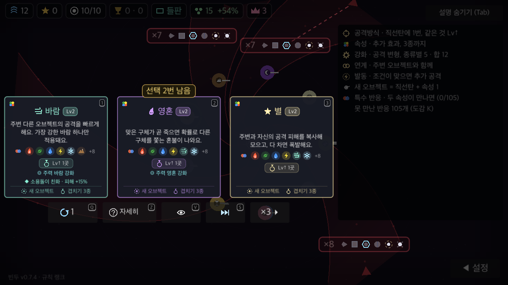
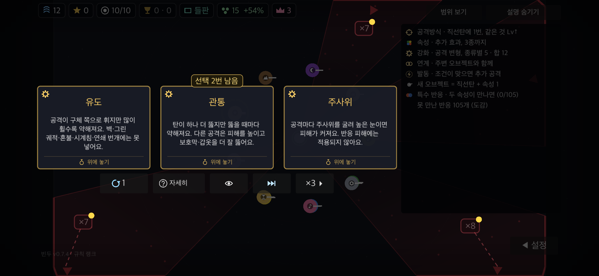

# 기본 카드 효과 설명 검증

2026-11-03. 기준 main `0c8e15b`, 브랜치 `codex/clear-basic-card-effects`.
macOS arm64·Godot 4.7.2·Python 3.13.9. 게임 버전·규칙 수치·카드 해금은 변경하지 않았다.

## 변경과 범위

- 15속성 기본 카드를 효과 이름 대신 주효과 문장으로 표시한다. 얼음은 냉기 누적, 땅·전기는 확률, 별은 피해 복사·충전 후 폭발임을 남긴다.
- 바람은 다른 오브젝트의 공격 속도와 가장 강한 효과 하나만 적용됨을, 영혼은 맞은 구체의 이른 사망과 확률을, 독은 지속 피해·사망 시 전염을 설명한다.
- 다른 종류도 기계적으로 괄호를 지우지 않는다. 다중 발사의 개별 피해 감소·유도/관통 감쇠·발동의 조건·보스 효과 절반·공명 거리·대격변의 대상과 레벨 유지 등을 기본 화면에 보존한다.
- 자세히 설명·형태 성질·반응 설명·반응 그림·레벨업 칩·기존 자세히 설정은 유지한다. 첫 판에만 적용하는 조건은 없다.

## 기능 검사

`GODOT=/tmp/bindu-hold-qa/Godot.app/Contents/MacOS/Godot tools/run.sh spec`

- 종료 코드 0, `SPEC 통과 (실패 0, 확인한 기능 173개)`.
- UI-20: 0·12·50웨이브에서 15속성 모두 문장 설명, 주요 조건, 반응 그림과 자세히 원문 보존, 자세히 설정 전환 확인.
- 실제 신규 플레이어의 이해도·선택 정확도는 이 검사로 판단하지 않는다.

## 렌더링 검사

서버 주소와 개인 저장을 분리한 사본에서 4개 프로필·각 12개 화면을 캡처했다.

| 프로필 | 창 해상도 요청 | 글자 크기 | 화면 수 |
|---|---|---|---|
| PC | 1280×720 | 100% | 12 |
| PC 큰 글자 | 1280×720 | 130% | 12 |
| 폰 안전 영역·터치 모의 | 2556×1179 | 130% | 12 |
| 태블릿 비율·터치 모의 | 2048×1536 | 130% | 12 |

15속성 전체, 블랙홀·음파·그린 궤적, 유도·관통·주사위, 선봉·축적·마무리, 공명·프리즘·협공, 대격변 두 종류, 자세히 앞면을 확인했다.
내용이 많은 바람·영혼·별에는 14가지 반응 그림(6개+나머지 수), 레벨업 칩, 주력 강화 안내를 넣었다. 추가로 바람의 소용돌이 친화 표시가 포함된 스트레스 화면도 확인했다.
48개 화면에서 UI OVERLAP·OFFSCREEN·CLIP, 기본 카드 본문 높이 초과, 스크립트 오류가 없었다. 기본 카드의 마지막 행과 하단 행동 안내가 잘리지 않는지 직접 확인했다.

48개 전체 캡처 후 독립 리뷰에서 유도 금지 대상의 혼불, 다중 발사의 피해 감소 예외(벽·블랙홀·투척 장판), 블랙홀의 다른 오브젝트 피해 흡수를 문장에 명시했다. 이 세 문장이 있는 공격방식·강화 화면은 4개 프로필에서 8개를 추가 재캡처해 오류가 없음을 확인했다. 최종 spec도 다시 173개 통과했다.

최종 렌더링 사본과 작업 소스의 main.gd·elem.gd·pattern.gd는 바이트 단위로 일치함을 확인했다.
원본 캡처·하네스·각 프로필 로그: `/tmp/bindu-card-clarity-qa/`.

## 종합 검사

개발 의존성을 설치한 가상환경에서 `tools/run.sh check` 실행. 아래 종합 결과는 독립 리뷰의 세 문장 보완 전 코드 기준이며, 보완 후에는 영향받는 화면과 직접 기능 검사를 다시 실행했다.

- 통과: 기능 173개·그린 궤적·fuzz 4개 시드(각 오류 0)·13웨이브 이어하기·온라인 서명·패치 키 적용·정원.
- 서버: `25 passed, 1 warning`.
- 전체 종료 코드 1: `CHECK 실패: rulekeys`. 사전에 기준 main에서도 확인된 `server/app/rule_keys.json이 오래됨` 문제이며 이번 변경은 규칙 수치나 해당 생성 파일을 수정하지 않는다.
- `python3 tools/notes_check.py`: `NOTES ok`. 내장 패치노트 재생성: 72개·최신 0.7.4, 생성 파일 변경 없음. `git diff --check`: 종료 코드 0.

종합 검사 로그는 `/tmp/bindu-card-clarity-qa/check.log`, 직접 기능 검사 로그는 `spec.log`다. 종합 검사는 고정 `/tmp/bindu_check_*` 파일 경합 가능성이 있어 직접 기능 검사 로그도 별도로 보존했으며, 실행 종료를 다음 에이전트에 알렸다.
폰·태블릿은 Mac에서 모의한 렌더링이다. 실제 모바일 기기 입력·신규 사용자 이해도·배포본은 미검증이다.
