# 하단 카드 도크 — 전후 비교와 검증

2026-11-03. 기준 main `0c8e15b`, Godot 4.7.2, macOS arm64.
별도 브랜치 `codex/fixed-bottom-card-dock`. 미병합 PR #6/#8/#9 코드는 포함하지 않는다.

일반 판을 중앙 전장·하단 카드 도크·오른쪽 정보 영역으로 나눈다. 선택·설치·방향·전투·일시정지에서 카메라 프레이밍을 유지한다.
실제 전장 1280×720·오브젝트 좌표·사거리·구체 이동·수치는 바꾸지 않는다. 남은 공간에 전체 전장을 맞추므로 **화면상 전장은 작아진다**.
카드 요약은 말줄임을 명시하며, 전체 효과·반응·적용 조건은 오른쪽의 자세히/스크롤로 읽는다. 정원은 기존 전용 레이아웃이다.

## 같은 조건의 비교

같은 검사 파일, 시드 17, 12웨이브 앞 쉬는 시간, 같은 속성/강화/공격방식 3장과 오브젝트 9개를 사용했다.
모서리 4개와 기존 중앙 카드 아래에 걸리는 대상을 포함한다. hover 신호와 터치 미리보기 함수로 상태를 만들고,
별도로 실제 Godot 입력 이벤트를 통해 변환된 화면 좌표의 대상 적용과 오른쪽 영역 입력 차단을 확인했다.
실제 사람이 마우스/터치를 조작하거나 이해도를 평가한 결과는 아니다.

| 조건 | Before | After |
|---|---|---|
| PC 1280×720 / 100% | 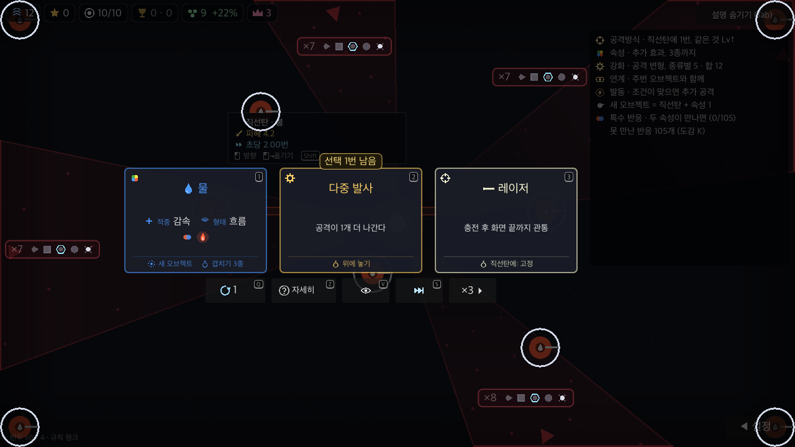 | 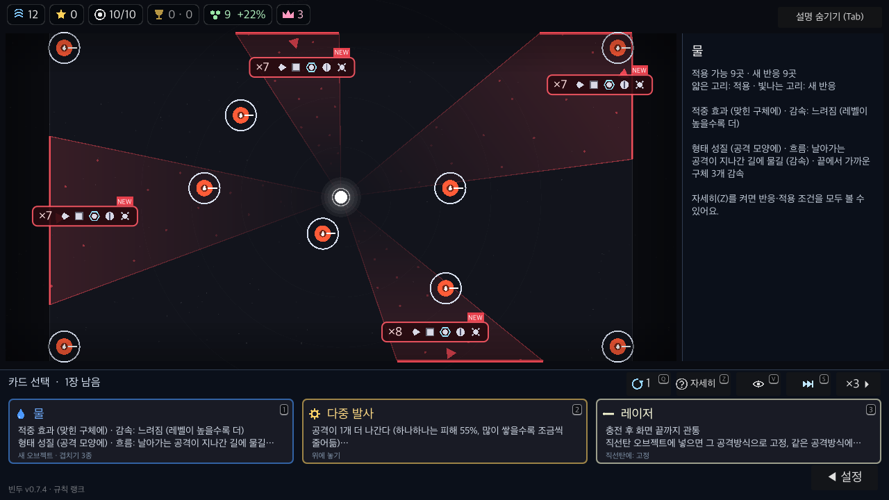 |
| PC 1280×720 / 130% | 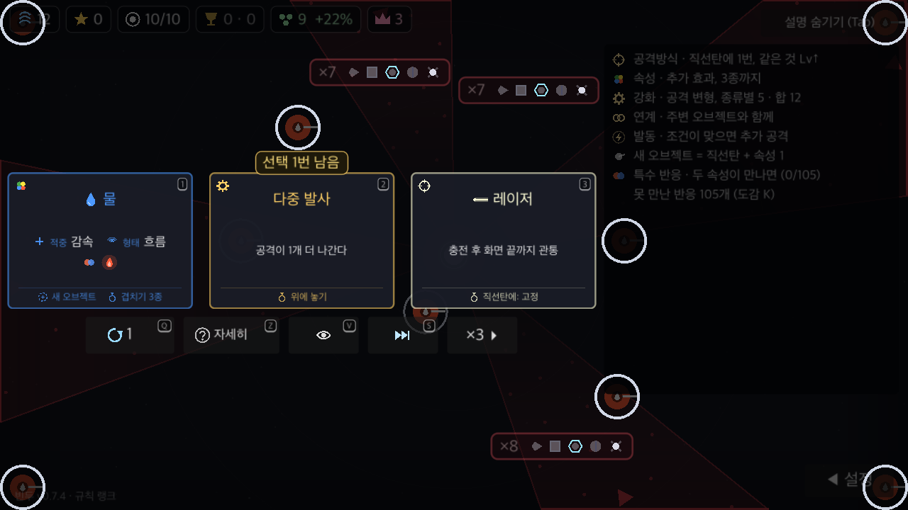 | 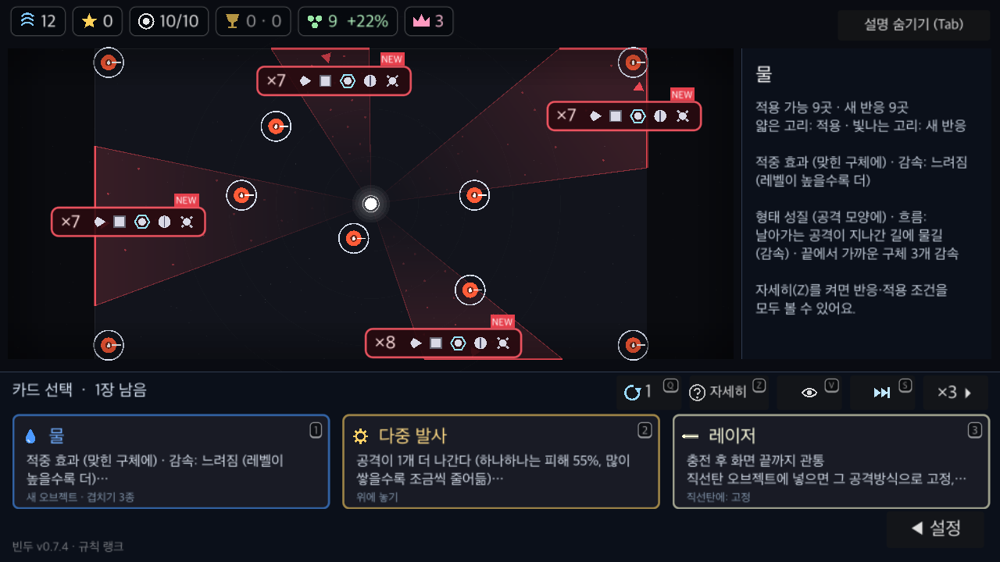 |
| 폰 모의 2556×1179 / 130%, 안전 영역 | 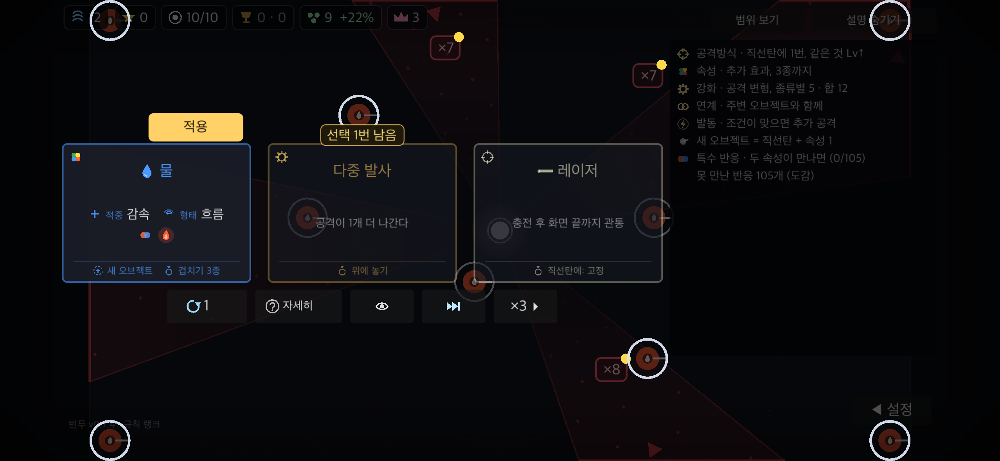 | 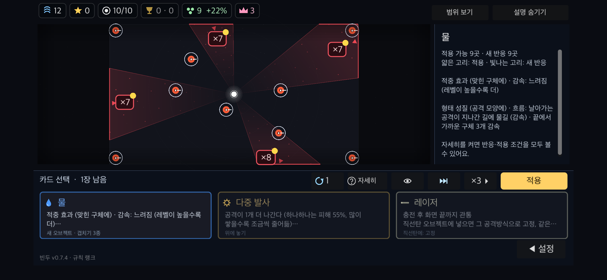 |
| 태블릿 모의 1366×1024 / 130% | 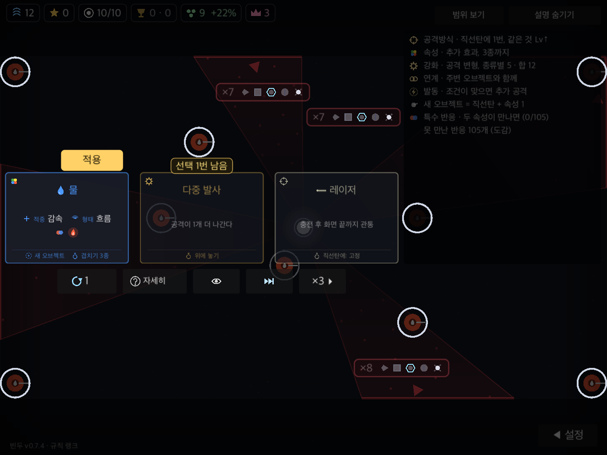 | 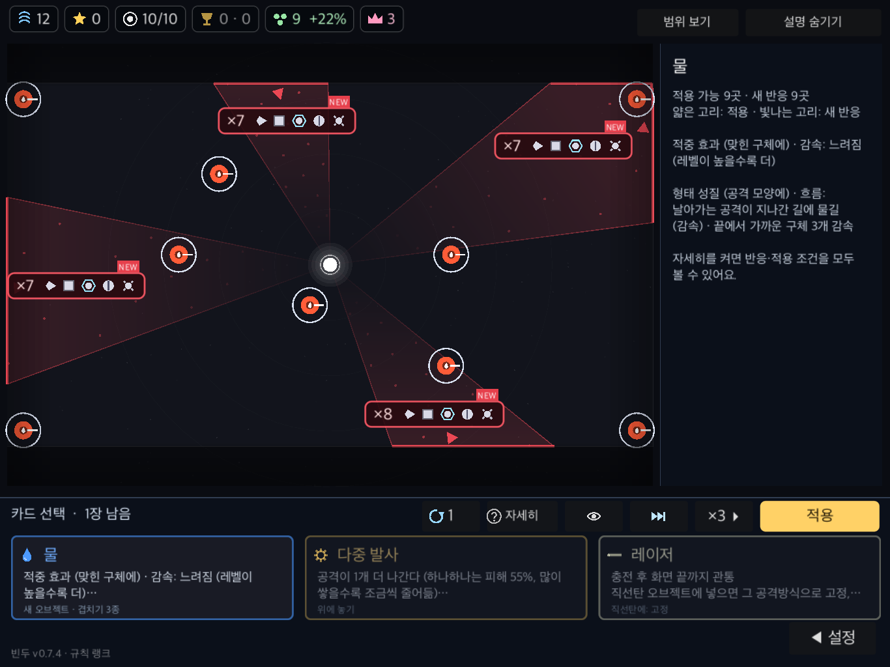 |
| PC 자세히 켬 | 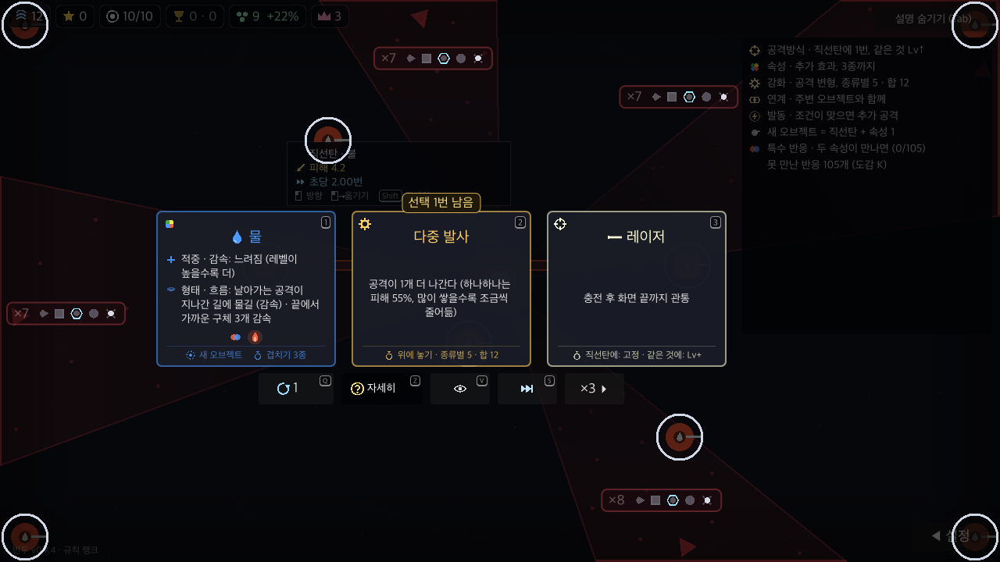 | 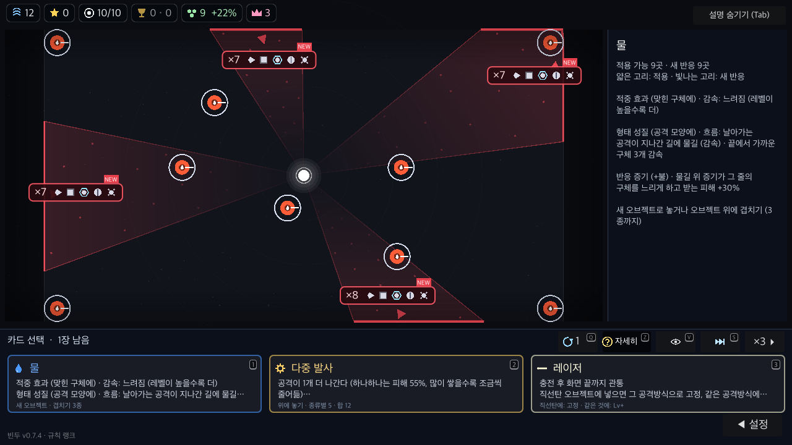 |
| PC 전투 | 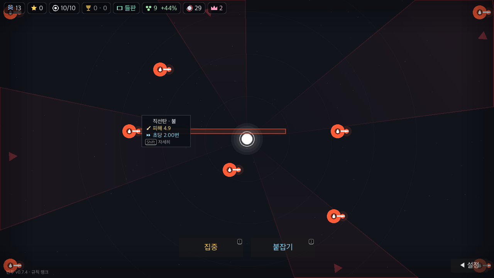 | 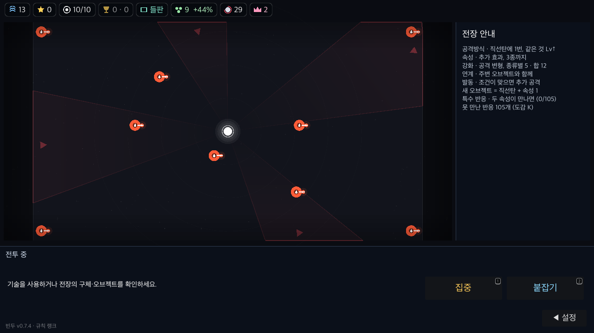 |

fixture에서 오브젝트 **중심**이 카드 영역과 겹친 수: PC 2→0, 큰 글자 1→0, 폰 모의 3→0, 태블릿 모의 1→0.
폰/태블릿은 Mac에서 화면비·글자 크기·터치 UI를 모의했다. 실기기 캡처가 아니다.
화면의 주변 부채꼴·범위 표시는 해당 fixture의 기존 게임 효과다. 적 생성·이동을 재생한 전투 영상은 아니다.

## 관측한 결과

- 최종 `tools/run.sh spec`: 기능 175개, 실패 0, 종료 코드 0. [로그](spec.log).
- 최종 native: 프로필 4개 × 상태 11개 = 44개 캡처. 모든 프로필 `DOCK failures=0`, 종료 코드 0, UI OVERLAP/OFFSCREEN/CLIP 0.
  상태: 카드 미리보기, 자세히, 접기, 설치, 대기, 전투, 확대, 특성, 설정 버튼 펼침, 일시정지, 그리기.
- 카메라 고정, 전장 모서리 포함 전체 표시, 논리 전장 크기, 취소·저장/이어하기, 대상 적용 상한/협동 소유권/요청 속성 확인.
- native 입력 이벤트: 변환된 좌표로 대상 조회·강화 적용, 오른쪽 영역 클릭의 설치/상자 선택 차단, 도크 휠의 전장 확대 차단 확인.
- 터치 미리보기→적용 분리, 자세히 전환 시 미리보기 유지, 그리기 적용·취소 분리, 시작 화면 복귀 시 카메라 복원 확인.
- 종합 `tools/run.sh check`: 기능175·path·fuzz4개 시드(오류0)·13웨이브 이어하기·online·patch keys·gcheck 통과.
  **전체 종료 코드 1**: `server/app/rule_keys.json이 오래됨`. 수정하지 않은 기준 main에서도 `VERIFY=1 tools/run.sh rulekeys`가 같은 실패/종료 코드 1.
  서버 검사는 현재 Python에 fastapi/pytest/httpx가 없어 건너뛰었다. [종합 로그](check.log), [기준 main 로그](baseline-rulekeys.log).
- 종합 검사 이후 일반 판 카드의 전장 위 툴팁 제거와 오른쪽 한글 줄바꿈을 마무리했고, 최종 소스에서 기능175개·native44개를 다시 확인했다.
- 마지막 기능 검사 과정 중 기존 확률 표본 검사 MAPX-01이 한 차례 164 대 135로 실패했다. 맵 수치·검사 임계값을 바꾸지 않은 재실행은 기능175개 통과했다. 해당 확률 검사의 변동 가능성은 남아 있다.
- `python3 tools/notes_check.py`: NOTES ok. `git diff --check`: 통과.

Before는 4개 프로필 × 8개 상태를 캡처했다. 기준 main의 태블릿 모의에서 설치·대기 진입 배지끼리 겹침 2건이 검출됐다.
Before를 전체 UI 통과로 취급하지 않는다. After의 동일 상태에는 해당 겹침이 없다.

## 재실행과 소스 연결

`tools/dock_check.gd`는 config/name이 `BinduTools`로 시작하고 온라인·멀티 주소가 빈 native 사본에서만 실행된다.
검사는 격리 사본의 기기 기록·best.cfg·run.cfg를 지운다. 실제 게임 저장 폴더에서는 실행하지 않는다.

```sh
godot --headless --path /path/to/isolated-copy --import
godot --path /path/to/isolated-copy --resolution 1280x720 -s tools/dock_check.gd -- /tmp/dock-desktop 1.0
godot --path /path/to/isolated-copy --resolution 1280x720 -s tools/dock_check.gd -- /tmp/dock-large 1.3
godot --path /path/to/isolated-copy --resolution 2556x1179 -s tools/dock_check.gd -- /tmp/dock-phone 1.3 phone
godot --path /path/to/isolated-copy --resolution 1366x1024 -s tools/dock_check.gd -- /tmp/dock-tablet 1.3 tablet
```

Before는 main `0c8e15b` 사본에 같은 검사 파일을 복사해 실행한다.
최종 게임 소스와 캡처 사본의 main.gd/card_dock.gd 바이트 일치, 이미지 쌍 해상도 일치와 SHA-256은 [manifest](capture-manifest.json)에 기록했다.
최종 전체 원본 캡처는 `/tmp/bindu-dock-qa/after/`, 비교 원본은 `/tmp/bindu-dock-qa/before/`에 있다.

## 남은 확인

- 실제 iOS/Android 터치·작은 화면에서 오브젝트 식별·장시간 플레이.
- 신규 플레이어의 카드/전장 비교 용이성, 하단 고정 영역으로 줄어든 표시 배율의 수용성.
- 배포본·온라인 멀티 실전 입력. 독립된 시각 리뷰는 실행하지 않았다.
