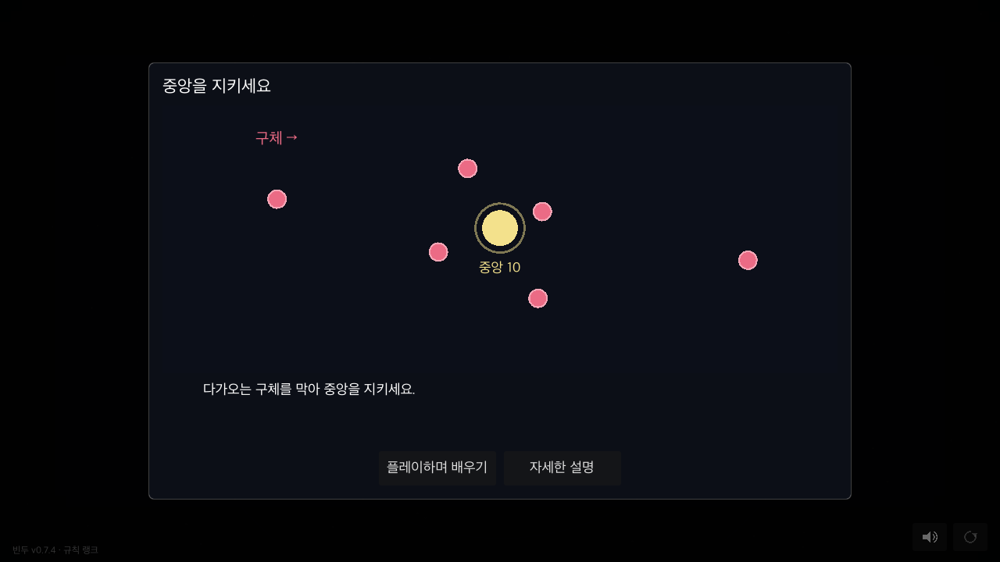
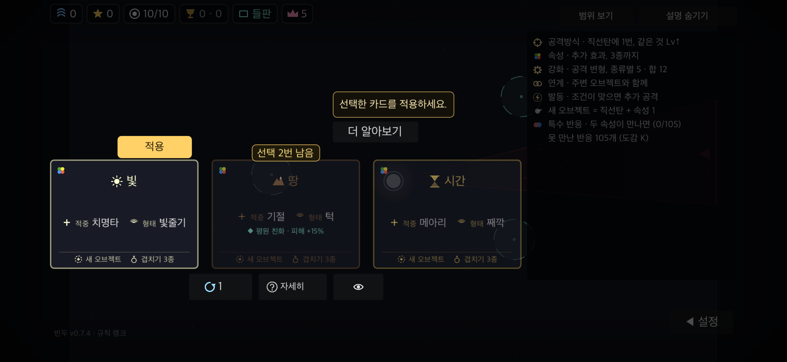

# 첫 실행 행동 안내 검증

2026-11-03, 기준 main `0c8e15b`. macOS arm64, Godot 4.7.2.

첫 실행의 강제 12장 설명 대신 목표 한 문장과 플레이/상세 선택을 제공한다.
첫 소개를 닫았다는 done과 직접 연 항목의 seen을 구분하며, 기존 기기 기록을 초기화하지 않는다.
첫 웨이브까지 실제 상태에 따라 행동 하나씩 안내하고 기존 카드 해금·수치·선택 횟수는 유지한다.
자동 모달 대신 단일 짧은 안내와 선택적인 상세 진입을 제공한다.




## 관측한 검사

- `GODOT=<Godot 4.7.2> tools/run.sh spec`: 기능 174개 통과, 종료 코드 0.
- 실제 창이 있는 격리 사본의 `tools/first_play_check.gd`: PC 100%·130%, 폰 화면비/안전 영역·터치 모의 130%에서 각각 종료 코드 0, `NATIVE FIRST failures=0`.
- PC 프로필 각각 6장·폰 8장, 총 20개 캡처의 UI OVERLAP/OFFSCREEN/CLIP 0.
- native 검사: 빈 device.cfg의 실제 `_tut_tick`에서 welcome 표시, 상세를 선택하면 goal만 열람 처리, 플레이→준비, 첫 두 번의 실제 `_after_place`, 중간 취소·필드 보기, 1장 남은 상태 저장/이어하기, 두 번째 배치 후 준비·웨이브 시작 확인.
- 이벤트에서 추가 모달·일시정지 없음, 돌아온 기기의 done과 미열람 상태 보존 확인.
- spec은 안내 끄기와 games가 있는 기존 사용자/안내 초기화 tutor 판을 명시 fixture로 구분한다. 안내가 떠 있는 중 설정을 끄면 안내와 더 알아보기가 즉시 숨겨지는지도 확인한다.
- `python3 tools/notes_check.py`, `git diff --check` 통과.

## 재실행

사본의 config/name을 BinduTools로 시작하도록 바꾸고 온라인 주소를 비운 뒤:

```sh
godot --headless --path /path/to/copy --import
godot --path /path/to/copy --resolution 1280x720 -s tools/first_play_check.gd -- /tmp/first-play 1.0
godot --path /path/to/copy --resolution 2556x1179 -s tools/first_play_check.gd -- /tmp/first-play-touch 1.3 touch
```

검사 실행은 실제 게임 저장/헤드리스 또는 서버·멀티 주소가 있는 사본에서는 거부한다. 격리 사본의 저장을 지워 새 기기 진입을 재현한다.
원본 로그·캡처: `/tmp/bindu-first-qa/`. 실제 모바일 기기 입력과 신규 사용자 이해도는 미검증이다.
자동 검사나 캡처만으로 학습 효과 개선을 주장하지 않는다.

안내가 보이는 중 상세 설명이 겹치는 native 사례를 확인해, 오른쪽 여유 공간이 있는 경우 카드 옆으로만 피하도록 보정했다. 보정 후 spec 및 20개 native 캡처를 다시 확인했다.

검증 사본과 원본 main.gd 바이트 일치 확인. SHA-256: `f2791f0d8826e0e6bfd4f042db56b3c006563c46ed19b4333c5d5b9fda066e67`.

## 종합 검사 범위

`tools/run.sh check`는 안내 끄기 반영 후·상세창 위치 보정 전 코드에서 실행했다. 기능174·궤적·fuzz4개 시드(오류0)·13웨이브 이어하기·온라인·패치 키 적용·정원·서버25개(경고1개) 통과. 기존 `server/app/rule_keys.json` 불일치로 전체 종료 코드1(`CHECK 실패: rulekeys`). 로그는 `/tmp/bindu-first-qa/check-final.log`.

이후 안내를 가리던 상세창 위치만 보정하고 최종 코드에서 기능174개와 native20개 캡처를 다시 통과했다. 종합 검사를 최종 HEAD 전체 통과로 주장하지 않는다.
