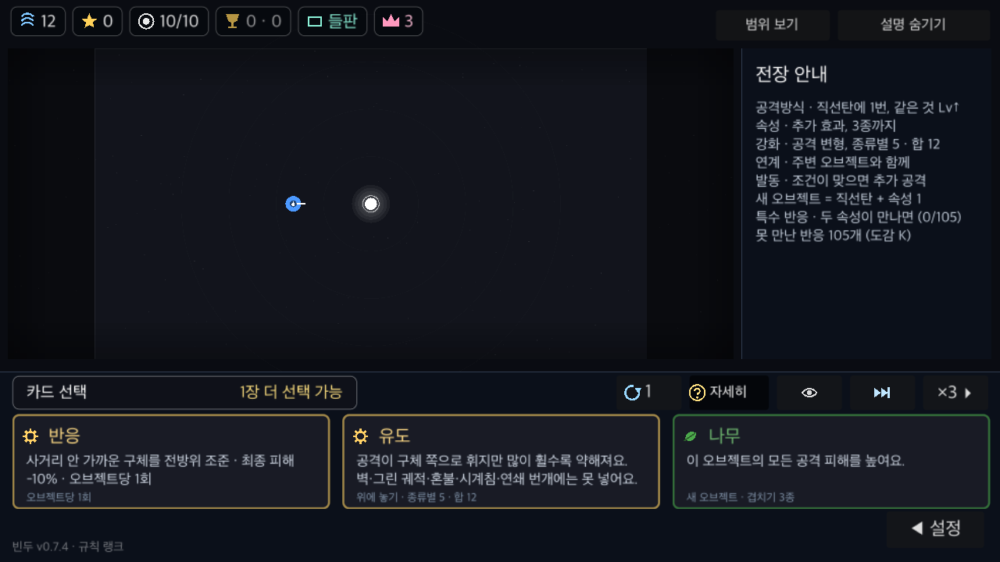
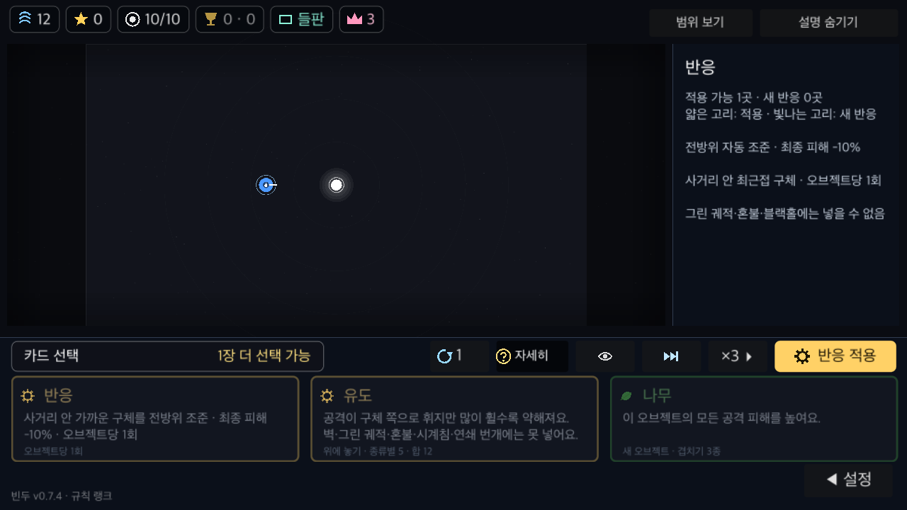
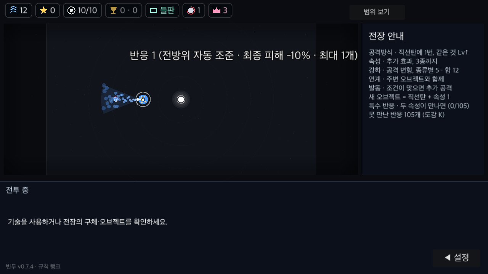
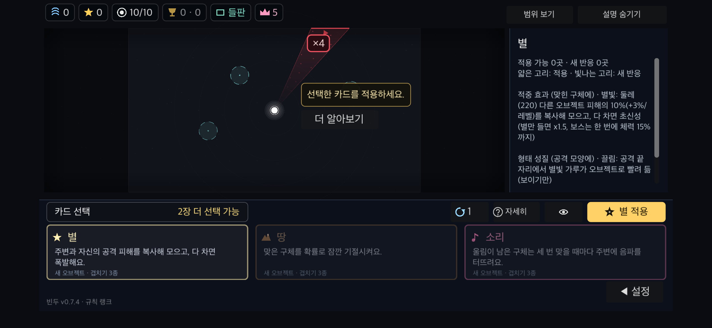
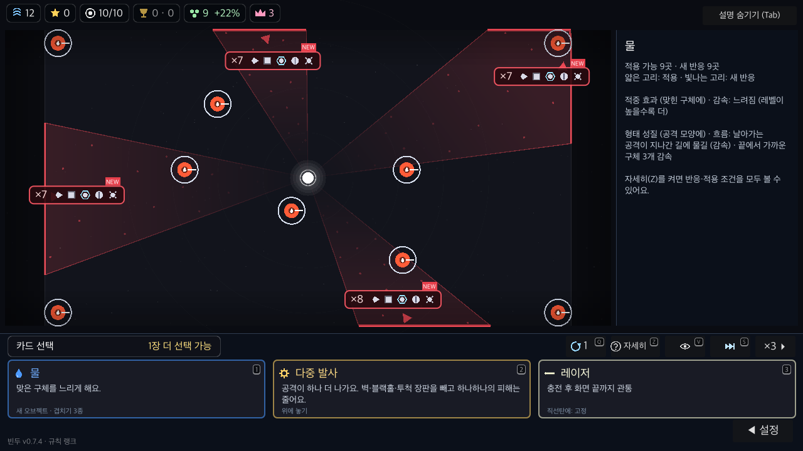

# PR #11 최신 main 통합 검증

2026-11-03. 기준 main `695d798` (#9까지 병합). 반응 강화 리뷰 수정 `a79f47a`를 포함한다.
기존 main/PR/리뷰 커밋을 모두 보존하는 merge이며 강제 push는 사용하지 않는다.

## 통합 내용

- 변경 기록 충돌은 반응 강화와 카드 도크·첫 실행 안내 항목을 모두 보존해 해결했다. 코드·명세·검사는 자동 병합 후 실행 검증했다.
- 반응 강화의 대기 중 쿨다운 중복 감소, 바람·폭풍 방향 보정과 모든 벽 슬롯의 감지 거리, 처형 낫 조건부 즉사 보존을 포함한다.
- `tools/run.sh rulekeys`로 생성 목록을 갱신했다. 이미 구현된 진입 시간 수치 4개만 추가됐으며 게임의 수치 값은 바꾸지 않았다.

## 최종 검증

- Godot 4.7.2 / macOS arm64. `GODOT=<Godot> tools/run.sh check`: **종료 코드 0, CHECK 통과**. [로그](check.log)
- spec 기능 **178개 통과**, 실패 0. 신규 반응 강화 및 리뷰 회귀 검사, 전장 고정·선택 헤더·짧은 효과·튜토리얼 모두 포함. [로그](spec.log)
- 그린 궤적, fuzz 4판(각 스크립트 오류 0), 13웨이브 이어하기, 온라인 서명, patch keys, rule keys, 정원·패치노트 검사 통과.
- 서버 pytest는 Python 환경에 fastapi·pytest·httpx가 없어 검사 도구가 건너뛰었다. 서버 테스트 통과로 해석하지 않는다.
- native 도크: PC 100%·130%·폰 안전 영역/터치 모의 130%, 33개 캡처, 각 `DOCK failures=0`·종료 코드 0.
- native 첫 실행: 같은 세 프로필 20개 캡처, 각 `NATIVE FIRST failures=0`·종료 코드 0.
- native 반응 카드: 1280×720 PC 100% / 터치 UI 130%, 앞면·상세·후방 공격 6개 캡처, 각 `REFLEXSHOT fails=0`·종료 코드 0.
- 총 **59개** 캡처. UI OVERLAP/OFFSCREEN/CLIP 0. `git diff --check`, `notes_check.py` 통과.

실행 사본은 `BinduToolsRemainingPRsFinal`, 온라인·멀티 URL은 비웠다. 게임 소스와 검사 도구는 캡처 사본과 바이트 일치한다. [소스 SHA-256](source-hashes.json), [캡처 수](captures.json).

`docs/qa/pr-11/REVIEW.md`의 no_ship 판정은 `a79f47a` 당시의 수치 목록 누락을 포함한 과거 검증이다. 이 통합본에서는 목록을 생성기로 복구하고 전체 check를 다시 통과했다. 실제 모바일 기기·실제 멀티 세션·배포된 빌드의 동작은 이번 검증 범위가 아니다.

