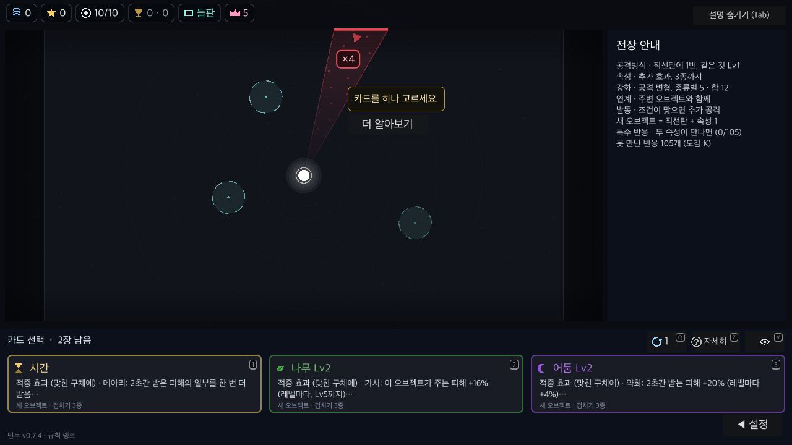
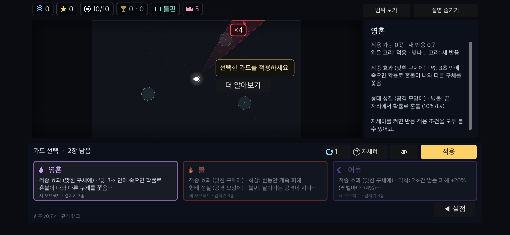

# PR #9 main 충돌 해결 검증

2026-11-03. 기준 main `a1687c9` (#10 하단 도크 병합 후).
기존 PR 커밋은 보존하고 main을 merge한다. 강제 push·main 병합·배포는 수행하지 않는다.

첫 소개/열람 기록 분리, 첫 웨이브 행동 안내, 더 알아보기와 경고 우선순위를 새 도크와 함께 유지한다. 진입 배지가 배너와 더 알아보기를 모두 피하도록 충돌 목록을 합쳤다.

- `tools/run.sh spec`: 176개 통과, 종료 코드 0. [로그](spec.log).
- Godot 4.7.2 / macOS arm64 native. PC 100%·130%·폰 안전 영역/터치 모의 130%의 도크 검사 33개 캡처, UI OVERLAP/OFFSCREEN/CLIP 0, 각 `DOCK failures=0`, 종료 코드 0.
- 고정 전장·카메라, 설치·취소·저장/이어하기·대기·전투·특성·확대·일시정지·그리기, 입력 좌표와 도크/오른쪽 클릭 차단 확인.
- 빈 기기 기록에서 첫 실행 검사: PC 100/130%·폰 모의 20개 캡처 모두 `NATIVE FIRST failures=0`, 종료 코드 0, UI 오류 0.
- `git diff --check`, 패치노트 문구 검사 통과. 실제 기기·배포본·신규 사용자 이해도는 미검증이다. 이번 검증에서 종합 검사와 서버 검사는 다시 실행하지 않았다.

실행 사본은 `BinduToolsConflictPR…`, 온라인/멀티 URL은 비웠다. main.gd·card_dock.gd는 캡처 사본과 바이트 일치하며 SHA-256은 [source-hashes.json](source-hashes.json)에 있다.
기존 QA 문서와 이미지는 이전 커밋의 증거로 보존하며 이 갱신의 검증과 구분한다.

