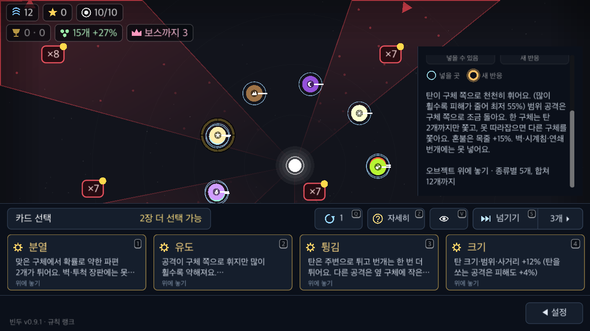
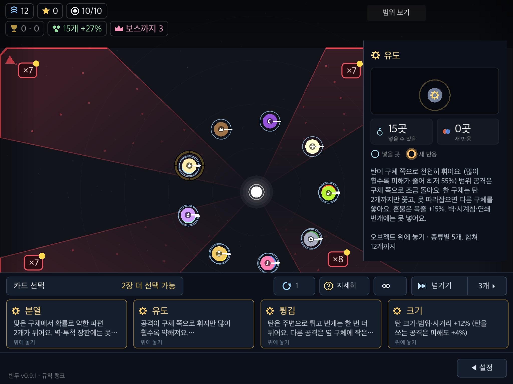

# 카드 문체 통일 검증

2026-11-04 · macOS arm64 · Godot 4.7.2.

## 변경 범위

- [문체 가이드](../../writing-guide.md): 설명 문장은 해요체, 수치·라벨은 생략형 허용, 조작 안내는 `~하세요.`.
- 속성 효과·특징·상성, 공격방식·강화·연계·발동, 자동 조준의 별도 요약·상세, 특성까지 78곳 교정. 이미 해요체인 요약은 유지했다.
- 도감은 같은 속성·공격방식·강화·연계·발동 설명 원문을 사용한다. 이름·수치 라벨·조합 화살표 표기는 유지했다.
- [인라인 교정 내역](copy-edits.md)에 삭제·추가를 표시했다.
- 숫자·부호를 포함한 숫자 토큰과 `{수치 키}`를 교정 전후 대조해 동일함을 확인했다([결과](preservation.json)). 확률·시간·거리·상한·보스 절반·발동 대상·금지 대상 등 조건도 원문 diff로 대조했다. 게임 수치는 수정하지 않았다.
- 검사 준비 중 발견한 도크 `width` 중복 선언은 작업 트리에서 `show_width`로 복구했다. 이 변경을 포함한 별도 도크·컨트롤 수정은 문체 커밋에서 제외했다.

## 자동 검사

- `GODOT=/Applications/Godot.app/Contents/MacOS/Godot tools/run.sh spec`: 기능 207개, 실패 0([로그](spec.log)). UI-20에 공유 원문·화면별 요약·상세의 구형 종결형 검사를 추가했다. 숫자 라벨은 허용한다.
- 숫자·단위 줄바꿈 회귀 검사: `12개까지`, `1.5초`, `40%를`의 연결·원문 보존·중복 처리 안전성을 확인한다.
- 문체 변경만 스테이징한 인덱스를 별도 사본으로 추출해 기능 207개·실패 0을 재확인했다([커밋 대상 검사 로그](spec-index.log)). 캡처는 진행 중이던 도크·컨트롤 수정도 포함한 작업 트리 기준이며, 해당 수정은 이 커밋에 포함하지 않는다.
- `git diff --check`: 통과.
- 원본 스냅샷 SHA-256: [source-hashes.json](source-hashes.json). 카드 원문·줄바꿈·레이아웃·렌더 검사 소스가 캡처 사본과 일치함을 대조한다. 캡처 중 별도 컨트롤 작업이 `main.gd`에 추가한 `bar.mouse_filter = Control.MOUSE_FILTER_IGNORE` 한 줄은 입력만 바꾸며, 입력을 끈 렌더 fixture에는 영향이 없다. 또한 카드가 접힌 상태의 다시 열기 버튼 y좌표가 `size.y - 52`에서 `action_y`로 바뀌었다. 캡처한 상태는 모두 카드가 펼쳐져 있어 해당 분기를 타지 않는다. 이 두 변경만 되돌려 대조하면 캡처 사본과 바이트 단위로 같다([차이 기록](source-differences.json)).

## 렌더링 검사

`tools/card_writing_check.gd`로 온라인·멀티 주소를 비운 `BinduToolsCardWriting` 사본에서 실행한다. 실제 저장과 분리했다. 렌더 상태는 프로그램으로 채우며, 외부 키·마우스 입력을 비활성화하고, 검사 전용 파생 장면에서는 포인터로 오브젝트를 고르는 기능만 끈다. 게임 설명 원문·배치·글꼴·줄바꿈·스크롤 코드는 그대로 쓴다. 입력 조작의 성공을 주장하는 검사가 아니다.

- 속성 15종·공격방식 정의 15종(직선탄 포함)·강화 9종·연계 2종·발동 6종·특성 15종, 총 62종.
- 네 장 선택지의 요약, 각 카드 전체 상세, 긴 상세의 스크롤 마지막 위치를 캡처한다. 특성은 단일 설명을 사용한다.
- 선택한 카드 이름·전체 상세 원문이 실제 설명창에 표시되는지, 가로 넘침·본문 높이·요약 줄 너비·스크롤 마지막 줄 도달·UI 겹침·화면 밖·잘림을 검사한다.
- 실제 130% 캡처에서 `12 / 개까지`로 갈라지는 문제를 발견해 공용 한글 줄바꿈 처리에 숫자·% 연결을 추가했다. 숫자나 단위를 바꾸지 않고 붙여 읽게 한다.
- 도크 요약은 기존 두 줄 말줄임을 허용한다. 상세에는 원문 전체가 남으며, 조건이 길면 스크롤한다. 문체 변경을 위해 글자 크기나 배치를 조정하지 않았다.

최종 4개 프로필에서 564개 캡처, 검사 실패 0건. PC 100% 126개·PC 130% 156개·폰 130% 156개·태블릿 130% 126개다. 대표 캡처에서 유도·블랙홀·별·운명의 동전의 줄바꿈과 긴 상세 마지막 줄을 직접 확인했다.





프로필별 실제 해상도·글자 크기·터치 여부·실패 수는 [results.json](results.json), 캡처별 본문·스크롤 범위는 [captures.json](captures.json)에 남긴다. Mac에서 폰 요청 높이 1179는 실제 렌더 높이 1180으로 정렬된다.

실행 예:

```sh
/Applications/Godot.app/Contents/MacOS/Godot --path /tmp/bindu-writing-qa/project --resolution 1280x720 -s tools/card_writing_check.gd -- /tmp/bindu-writing-qa/desktop 1.0
/Applications/Godot.app/Contents/MacOS/Godot --path /tmp/bindu-writing-qa/project --resolution 1280x720 -s tools/card_writing_check.gd -- /tmp/bindu-writing-qa/large 1.3
/Applications/Godot.app/Contents/MacOS/Godot --path /tmp/bindu-writing-qa/project --resolution 2556x1179 -s tools/card_writing_check.gd -- /tmp/bindu-writing-qa/phone 1.3 phone
/Applications/Godot.app/Contents/MacOS/Godot --path /tmp/bindu-writing-qa/project --resolution 2048x1536 -s tools/card_writing_check.gd -- /tmp/bindu-writing-qa/tablet 1.3 touch
```

원본 전체 PNG는 `/tmp/bindu-writing-qa/{desktop,large,phone,tablet}/`, 대표 캡처와 프로필별 로그는 이 폴더에 보존한다.

## 한계

폰·태블릿은 Mac 모의 렌더링이다. 실기기·실제 스크롤 제스처·운영 `perk_desc` 덮어쓰기·배포본은 확인하지 않았다. 일부 native 실행 종료 때 ObjectDB 인스턴스 누수 경고가 남으며, 렌더 검사 실패와 별도로 로그에 보존한다. 이번 변경에서 관련 수명 관리는 수정하지 않았다.
