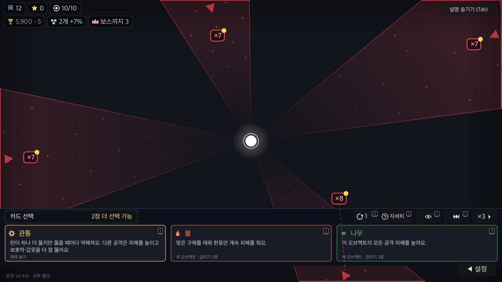
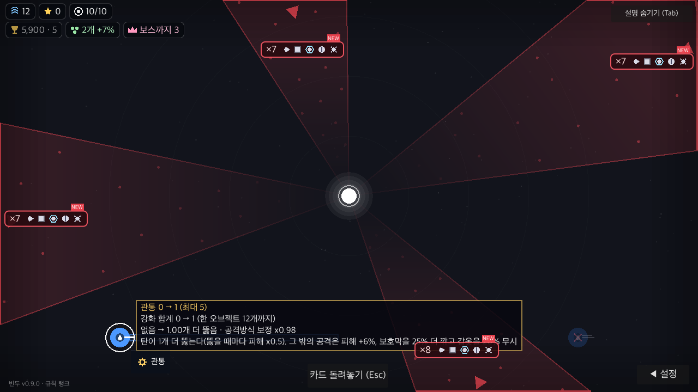
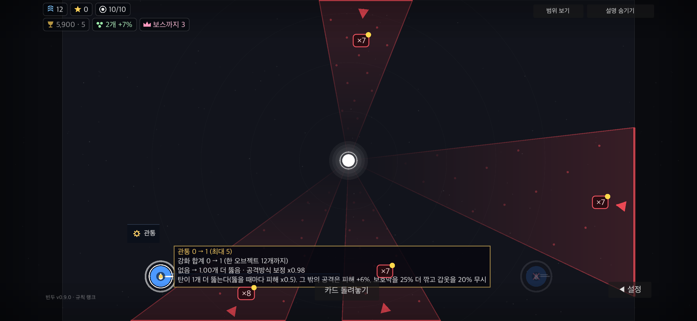

# PR #13 충돌 해결과 전체 검사 복구

2026-11-04. PR 브랜치 `codex/ui-overhaul`의 `6146a6e`에 최신 main `1b8d6df`를 병합했다. main 브랜치에는 직접 커밋하지 않는다. 기존 커밋을 재작성하지 않는 병합이다.

## 통합 기준

충돌 7개 파일(CHANGELOG, features, CardDock, main, admin.html, 서버 main.py, spec_check)을 양쪽 의도에 맞춰 해결했다. main의 0.9.0 효과·특징 공유·어드민 하위 탭·iOS 변경과 PR의 카드 들기·전장 크기 독립을 함께 유지한다. main의 웨이브별 도크 확대/축소 전환은 PR의 전장 고정 계약으로 대체한다. 관리자 키 목록은 두 생성기를 다시 실행해 대조했다.

## 실패 원인과 수정

- 삭제된 대격변 메서드 호출, 옛 웨이브 수 공식과 카드 효과 검사는 최신 main의 수정으로 복구했다. 문서의 대격변 선택지 잔여 문구도 정리했다.
- 시작 전 공격 배치 확인이 멀티 대결의 추가 구체·잠수 진행을 막았다. 혼자 판에만 이 차단을 적용하고, 협동 준비 동기화와 멀티 자동 진행을 보존한다. 빈 배치·잘못된 방향·유효 배치·협동 시작을 WAVE-14에서 확인한다. 사거리는 현재 Tower 계산을 재사용한다.
- 오브젝트 하나일 때 삭제된 프리즘을 뽑던 풀을 현재 연계 목록으로 정리했다. 반복 추첨과 서버 패치 검증으로 재발을 막는다.
- DPS 줄과 시간 되풀이의 lambda가 이미 해제된 오브젝트/구체를 캡처해 오류를 냈다. 약한 참조로 읽고, 대상 삭제 후 hover·예약 효과 실행을 회귀 검사한다.
- 서버 주소가 빈 격리 사본에서 리더보드를 열면 잘못된 URL을 요청했다. 빈 주소는 요청 전에 오프라인 응답으로 끝낸다.
- 이어하기 봇이 새 진입 방향을 방치해 목표 전에 끝나도 종합 검사는 RESULT 한 줄로 통과했다. 저장 비교 뒤 길목별로 배치를 정리하고, 13웨이브 도달 및 4·8·12웨이브 복원을 모두 요구한다. 막히면 무의미하게 반복하지 않고 원인을 출력한다. 불사 설정은 검사 도구에만 적용한다.
- spec 성공 문구 뒤 런타임 오류/비정상 종료, fuzz 미완료/비정상 종료, pytest 종료 코드가 통과로 가려지지 않게 했다. 가짜 실행기로 성공·오류·누락·비정상 종료 8개 경로를 검사했다.
- 최신 효과 문장이 길어진 폰 미리보기에서 하단 조작 안내가 겹쳤다. 대상을 가리키면 적용 미리보기가 안내를 대신하고, 벗어나면 안내가 돌아온다. UI-25 spec 및 native 세 화면에서 확인한다.

## 최종 검증

Godot 4.7.2 macOS arm64, Python 3.13 가상환경에 server/requirements-dev.txt 그대로 설치. 저장 이름 `BinduTools…`와 빈 온라인·멀티 주소를 쓴 격리 사본이다. 실제 저장과 서비스는 사용하지 않았다.

| 검사 | 결과 | 근거 |
|---|---|---|
| `tools/run.sh check` | 종료 0, CHECK 통과 | [check.log](check.log) |
| 전체 spec | 실패 0, 203개 기능 확인 | [spec.log](spec.log) |
| path · fuzz | path 통과, 4시드 × 3,000프레임 오류 0 | [check.log](check.log) |
| 이어하기 | 4·8·12웨이브 OK, 13웨이브 도달 | [check.log](check.log) |
| 온라인 서명 · 패치 키 · 생성 목록 · 정원 | 모두 통과 | [check.log](check.log) |
| 서버 pytest | 26 passed | [server.log](server.log) |
| 검사기 실패 감지 | 8/8 기대 종료 코드 | [runner-regression.log](runner-regression.log) |
| 카드·튜토리얼 집중 spec | 실패 0, 6개 기능 | [carry-spec-final.log](carry-spec-final.log) |
| native UI | PC 100%·130%, 폰 모의 130% 각각 12개 캡처, CARRY failures=0 ui=0 | [PC](desktop-final.log) · [큰 글자](large-final.log) · [폰](phone-final.log) |

총 36개 native 캡처를 실행했고 대표 3개를 여기에 보존한다. 마우스·드래그·터치 입력, 무효 대상·취소·앱 전환·확대·일시정지, 카메라 독립과 대상 안내 겹침을 포함한다. 대표 PC/폰 화면도 직접 확인했다.

[source-hashes.json](source-hashes.json)은 검사한 코드·기능 계약의 SHA-256이다. 사본은 온라인 주소와 저장 이름만 바꾸며, 나머지 검사 대상 코드·기능 계약은 작업 트리와 바이트 대조했다. 이전 실패 이력은 [11월 3일 기록](../2026-11-03-card-carry/README.md)에 그대로 남긴다.

서버 Starlette의 의존성 deprecation 경고와 native/spec fixture 종료의 ObjectDB 정리 경고는 남는다. 이번 결과는 실기기 성능·실제 두 기기 멀티 세션·배포 검증을 포함하지 않는다.

