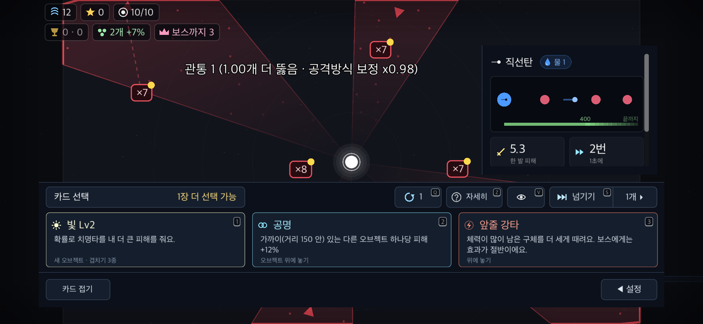

# 커서·포커스를 점유하지 않는 자동화

2026-11-04 · macOS arm64 · Godot 4.7.2.

## 변경

- `tools/run.sh ui`가 저장을 분리한 사본에 시작 전 `no_focus`·최소화를 설정한다. UI 사본의 서버·멀티 주소는 비우고 오디오는 Dummy로 실행한다. 원본 게임 설정은 바꾸지 않는다.
- `tools/virtual_input.gd`가 별도 SubViewport를 만들고, 주입하는 동안의 이벤트만 실제 `_input` → GUI → `_unhandled_input` 경로에 전달한다. OS 창은 최소화하고 팝업은 Viewport 안에 둔다. 실제 OS 입력은 검사 장면으로 전달하지 않는다.
- Input 상태 갱신·터치 마우스 에뮬레이션은 유지한다. 포인터 좌표는 게임의 입력 이벤트에서 보존하고 현재 카메라로 변환한다. 화면 물리 해상도·논리 크기·stretch 변환을 분리해 폰 비율에서도 같은 대상을 누른다.
- UI·캡처·fuzz 도구의 커서 강제 이동·창 전면 활성화를 제거했다. 이미지도 검사 Viewport에서 읽는다. 카드 문체 검사의 전용 오브젝트 선택 차단 파생 장면은 제거하고 실제 게임 장면을 사용한다.
- 도크 검사의 오래된 적용 버튼 기대를 현재 한 번 눌러 들기 동작으로 맞췄다. 팔레트가 전장을 덮지 않는다는 오래된 단언 대신, 팔레트를 접고 실제 GUI 경로로 대상을 누르는 검사를 유지한다. 첫 행동 안내 검사는 방어 방향 정책과 분리해 웨이브 시작을 확인한다.

## 검증

- `spec`: 기능 208개, 실패 0. UI-34에서 이벤트 좌표·카메라 변환과 도구 전체의 금지 API·공용 입력 경로를 검사한다.
- PC 100% 및 폰 비율 130%의 `carry_check.gd`: `CARRY failures=0 ui=0`. 클릭·드래그·무효 대상·Esc·앱 전환 통지·수정키·휠·일시정지 복귀·터치 에뮬레이션 켬/끔·두 손가락 확대·방향 확정·중복 소비 방지를 확인했다.
- native UI-34: 가상 포인터를 세 좌표로 옮겨도 OS 커서 위치 불변. 시작 설정 `no_focus=true`, root `unfocusable=true`, 최소화 상태, 창 포커스 없음. 논리 화면 크기와 물리 렌더 해상도도 원본 창과 일치한다.
- 외부 AppKit 관찰: 검사 프로세스 실행 중 전면 앱을 20ms 간격으로 확인했다. 검사 Godot 프로세스가 새 전면 앱이 된 횟수는 0. 커밋 대상 PC 검사에서는 592개 표본 동안 전면 앱 변경 자체도 0건이었다(`focus-index.log`). 관찰 프로그램은 포커스·커서를 변경하지 않는다.
- fuzz: 4개 시드·각 3000프레임, 스크립트 오류 0.
- 도크·첫 실행·카드 문체·기본 shot·툴팁·이벤트·맵·순위·후반·자동 조준·초신성·리더보드·투표·멀티·UI 스트레스 캡처를 가상 Viewport로 실행했다. 카드 문체 130%는 전체 62종·156개 캡처 검사 실패 0.
- `git diff --check`: 통과. 커밋 대상만 추출한 사본에서 기능 208개·PC 가상 GUI·기본 캡처를 재실행했다. PC 가상 GUI는 실패 0·UI 오류 0, 기능 검사도 실패 0이었다.

실행 예:

```sh
GODOT=/Applications/Godot.app/Contents/MacOS/Godot tools/run.sh ui carry_check.gd /tmp/carry 1.0
RESOLUTION=2556x1179 GODOT=/Applications/Godot.app/Contents/MacOS/Godot tools/run.sh ui carry_check.gd /tmp/carry-phone 1.3 phone
GODOT=/Applications/Godot.app/Contents/MacOS/Godot tools/run.sh ui shot.gd /tmp/screens 1.3
```

원본 PNG는 `/tmp/bindu-virtual-qa/`에, 대표 이미지·검사 로그·OS 관찰 코드는 이 폴더에 보존한다. 폰 요청 해상도 2556×1179는 Mac 렌더러에서 2556×1180으로 정렬된다.



## 기존 화면 경고와 검증 한계

- UI 스트레스 캡처의 겹침·화면 밖 경고 3건은 변경 전 런타임 `40dd0d9`에서도 같은 좌표로 재현됐다. 투표 캡처 경고 40건도 별도 새 저장으로 비교하면 동일하다. 입력 격리 작업에서는 화면 배치·투표 말줄임을 수정하지 않았다. `baseline-audit.log`, `baseline-vote.log`에 비교 증거를 남겼다.
- 기본 shot 130%에도 인스펙터·진입 배지·기술 버튼·넘기기 상태의 레이아웃 경고가 남는다(`shot.log`). 이 항목은 변경 전과 완전히 동일하다고 판정하지 않았으며, 입력 동작 통과와 구분한다. 입력 격리 작업에서 화면 배치를 수정하지 않았다.
- 일부 native 종료 시 기존 ObjectDB 인스턴스 누수 경고가 남는다. 오류를 숨기지 않고 로그에 남겼다.
- 폰은 Mac에서 화면비·안전 영역·터치를 모의했다. 실기기·Windows/Linux·실제 OS 드라이버 입력·사용자 조작에 의한 OS 창 전환·배포본은 검증하지 않았다. 실제 OS 입력이나 창 포커스 시험은 별도 요청이 있을 때만 실행한다.
