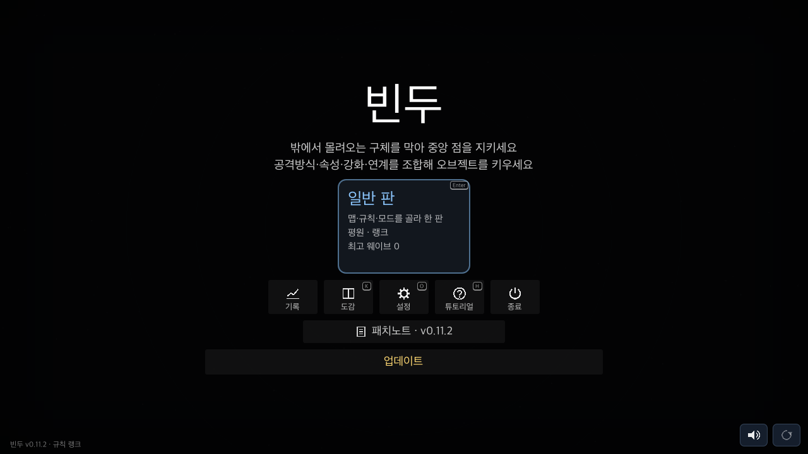
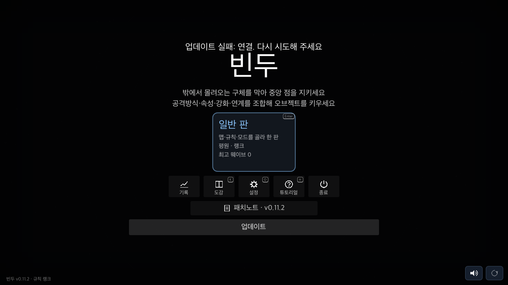

# 인앱 업데이트 확인 (2026-11-06 KST)

이 기록은 Windows 확인 시점의 결과다. 이후 macOS 구현·실기 검증은 [후속 QA](../2026-11-06-macos-in-app-update/README.md)에 기록했다.

## 결과와 범위

- 운영 서버의 Windows 릴리스 등록과 실제 ZIP 검증은 정상. Windows에서 업데이트가 실패한다는 사용자 재현 보고는 없으므로 원인을 추정해 서버를 변경하지 않았다.
- 시작 화면 이름을 [업데이트]로 통일. 버전·변경 내용은 툴팁과 패치노트에 유지. 실패하면 앱 안에서 같은 릴리스를 다시 시도한다.
- iOS의 App Store/TestFlight, Android의 Google Play 링크를 플랫폼별로 구분. 다른 플랫폼 스토어와 유사 도메인은 허용하지 않는다.
- Windows에서 실행 중인 EXE의 교체·새 프로세스 실행은 **미검증**. Mac 환경에서 가짜 다운로드 시작 객체로 버튼 흐름을 검사한 결과와 구분한다.
- 새 빌드·릴리스 등록·서버 배포는 수행하지 않았다. 현재 체크아웃은 0.11.2이며 운영 릴리스는 0.11.3이다. 현재 체크아웃의 버전 그대로 내보내면 최신 릴리스로 등록하면 안 된다.

## 운영 응답·파일

`GET https://bindu.anon-chat.kr/v1/boot?game=0.0.0&platform=windows&patch=8`

- 최신 버전: `0.11.3`
- URL: `https://github.com/lenope1214/Bindu/releases/download/v0.11.3/Bindu-windows.zip`
- 크기: `41137236` bytes
- SHA-256: `6053c35870f86cd215de9f666bc57646c71e3ae45e9243e75a51ae5adbb48e0d`
- 실제 Godot HTTPRequest: result `0`, HTTP `200`. 내장 공개키로 릴리스 서명 검증 성공.
- 실제 ZIP: 등록 해시·크기 일치, `Bindu.exe` 하나, Windows MZ 헤더·내장 PCK 푸터 확인.
- 배포 EXE의 PCK를 열어 Godot 프로젝트 버전 `0.11.3`, `scripts/updater.gd`·`scripts/features/online.gd` 포함 확인. 이는 Windows에서 EXE를 실행한 검증이 아니다.
- 같은 요청에서 `platform=macos`, `ios`, `android`는 `latest=null`. 세 플랫폼은 현재 서버의 업데이트 안내 대상 릴리스가 없다.
- Python 기본 urllib 요청은 403을 받았으나 curl과 실제 Godot 요청은 200. Python 결과를 게임 접속 장애로 판정하지 않았다.

## 회귀 검사

기존 HEAD의 `online.gd`를 저장·네트워크 분리 사본에서 실행한 결과:

```text
BEFORE text=새 버전 v9.9.9 받기 · test
```

수정 후 실제 native 창·가상 마우스 입력으로 21개 검사 통과:

```sh
GODOT=/Applications/Godot.app/Contents/MacOS/Godot tools/run.sh ui update_flow_check.gd /tmp/bindu-update-ui
```

- 화면에 보이는 버튼 클릭 → 배포 페이지 이동 또는 자동 업데이트 시작 요청.
- 클릭 처리 중복 없음, 다운로드 중 버튼 비활성화, 진행률.
- 다운로드 중 새 boot 응답이 버튼을 숨기거나 활성화하지 않음.
- 실패 후 [업데이트]로 복귀·이유 안내·원래 릴리스 재시도.
- iOS/Android 스토어 구분, TestFlight, 외부 ZIP·유사 도메인 차단.
- 새 버전이 없으면 버튼 숨김·릴리스 초기화.
- `UPDATE FLOW failures=0`. 종료 시 ObjectDB 인스턴스 2개 누수 경고가 있으며 기존 HEAD의 분리 실행에서도 같은 수의 경고가 나타났다.

실제 운영 응답을 `boot.json`으로, URL의 ZIP을 저장한 뒤:

```sh
/Applications/Godot.app/Contents/MacOS/Godot --headless --path . -s tools/update_check.gd -- --release /tmp/bindu-update-audit/windows.json /tmp/bindu-update-audit/Bindu-windows.zip
```

- 서명·변조 거부·ZIP 해시·크기·단일 EXE·Windows 헤더·내장 PCK 7개 검사 통과.
- 같은 응답에서 버전만 `99.0.0`으로 바꾼 경우 `UPDATE RELEASE FAIL`로 거부.
- `tools/run.sh spec`: spec 기능 238개, 실패 0.
- `tools/online_check.gd`: 기존 서명/HMAC/패치 검사 모두 통과.
- Godot import: 스크립트 오류 없음. `python3 tools/notes_check.py`: `NOTES ok`. `git diff --check`: 통과.

## 화면

정상 안내와 실패 후 재시도 상태. 각 캡처는 개인 저장과 네트워크를 분리한 QA 사본이다.




## 남은 Windows 실행 확인

1. 쓰기 가능한 폴더의 구버전 단일 EXE에서 최신 버전 안내가 나오는지 확인.
2. [업데이트] 클릭 → 진행률 → 기존 프로세스 종료 → 새 버전 자동 실행 확인.
3. 새 앱 버전, 진행·이어하기 보존, `.old`·`.new`·임시 ZIP 정리 확인.
4. 네트워크 단절/쓰기 불가 시 기존 EXE가 유지되고 재시도 가능한지 확인.

현재 Mac에는 Windows 실행 환경이나 연결된 Windows 호스트가 없다. 이 확인이 끝나기 전에는 Windows의 실제 교체·재시작까지 성공했다고 표시하지 않는다.
