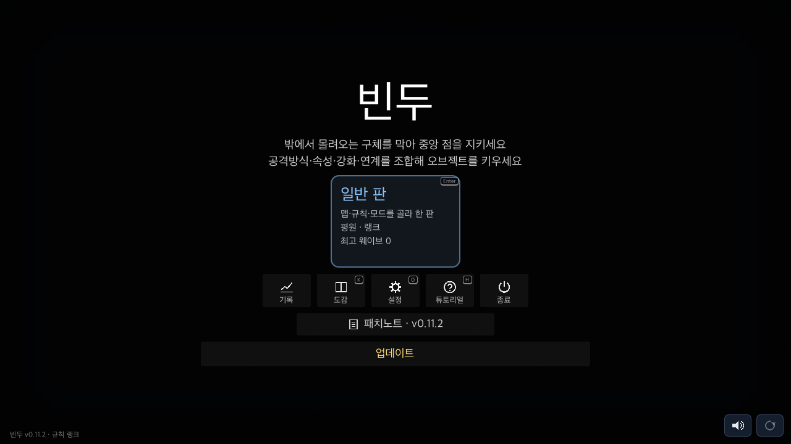

# macOS 자체 업데이트 QA — 2026-11-06

브랜치: `feat`. 기준 HEAD: `0bdf3349142952f39e60fa1785195d9737a77826`.
기존 Windows 업데이트 변경과 무관한 사용자 UID 파일은 보존했다.

## 구현

- 공용 `/v1/boot` 릴리스 형식과 RSA 공개키를 재사용한다. `macos` 릴리스도 ZIP 해시·크기 자동 계산을 지원한다. API·DB 마이그레이션은 없다. 기존 서버에도 해시·크기를 명시해 macOS 릴리스를 등록할 수 있다.
- 홈화면 [업데이트] → HTTPS ZIP 다운로드 → 서명·해시·크기 검증 → `.app` 코드 서명·버전·개발자 검증 → 앱 종료 → 번들 원자적 교환 → 재실행.
- 새 앱 시작 확인이 없거나 새 프로세스가 종료되면 이전 앱을 복구하고 다시 실행한다. 관리자 권한이나 Sparkle은 사용하지 않는다.
- Windows는 기존 EXE 교체 경로, 모바일은 스토어 이동을 유지한다.
- `build_macos.command`와 macOS export preset으로 설치용 `.app`과 ZIP, Intel·Apple Silicon 공용 helper를 빌드한다.

## 실제 Godot 앱 업데이트

```sh
python3 tools/macos_update_smoke.py
```

실제 Bindu 프로젝트를 별도 이름·저장·시험 RSA 키·로컬 CA로 내보내 실행했다. 로컬 HTTPS의 서명된 릴리스를 **실제 시작 화면 버튼 콜백**으로 실행했다. 가짜 Updater를 사용하지 않는다. 마우스 입력은 별도 `update_flow_check.gd`에서 검사한다.

- 구버전 `0.0.1`, 새 버전 `0.0.2`.
- 이전 프로세스 PID `90936`, 새 프로세스 PID `90970`.
- 구버전 boot → ZIP GET → 새 프로세스의 `game=0.0.2` boot 요청, 모두 HTTPS 200.
- 새 앱의 실제 프로젝트 버전과 설치 번들 plist 버전 모두 `0.0.2`.
- 최고 웨이브 `7`, 최고 점수 `350` 보존.
- 자동 저장 `run.cfg` SHA-256 일치, 저장된 웨이브 `4`, 새 앱에서 [이어하기] 표시.
- 별도 저장 파일 내용 보존, 준비 폴더 삭제 확인.
- 교체 후 `codesign --verify --deep --strict` 성공. 앱 로그에 스크립트 오류 없음.

원문: [결과](smoke-result.json), [HTTPS 요청](https.log), [실제 앱 로그](app.log).

## 실패·파일 시스템 검사

```sh
python3 native/macos/tests/test_updater.py
```

**12개 통과**. 한글·공백 설치 경로에서 실제 앱 실행·교체를 검사했다.

- 정상 교체·새 프로세스 실행·시작 토큰·임시 폴더 정리·저장 보존.
- 새 앱 즉시 종료 시 기존 앱 복구·재실행.
- 새 앱이 살아 있어도 시작 확인이 없으면 45초 후 종료·복구·기존 앱 재실행.
- ZIP 해시 불일치, 손상 ZIP, 경로 탈출, 외부 심볼릭 링크, 앱 코드 서명 변조, 다른 번들 ID·버전 거부.
- 실행 권한·정상 내부 심볼릭 링크·코드 서명 보존.
- 동시 교체 잠금, 쓰기 불가 설치 폴더 거부·기존 앱 보존.

[네이티브 검사 로그](native-tests.log). [설계·상태 파일](../../../native/macos/README.md).

## 회귀 검사

- `tools/run.sh check`: 통과. spec 기능 238개, 공격 미리보기 일치 검사, 튜토리얼, fuzz 4회, 13웨이브 이어하기, 온라인·패치·키·구조 검사 포함. [전체 로그](check.log)
- 위 명령은 기본 Python의 서버 의존성 부족으로 서버 부분을 건너뛰었다. 별도 venv에서 `pytest -q server/tests`를 실행해 **28개 모두 통과**했다. 외부 라이브러리 DeprecationWarning 1개. [서버 로그](server-tests.log)
- 실제 GUI 가상 마우스 입력의 업데이트 버튼·진행률·재시도·스토어 주소 검사 **21개 통과**. 종료 시 기존 검사에서도 나타나던 ObjectDB 인스턴스 2개 누수 경고가 있다. [로그](update-flow.log)
- `bash -n build_macos.command`, Python 검사 도구 컴파일, `tools/notes_check.py`, `git diff --check` 통과.



## 빌드와 검증 한계

`./build_macos.command` 성공. 결과: `build/macos/Bindu.app`, `build/macos/Bindu-macos.zip`.
버전·크기·SHA-256·helper 소스 해시: [빌드 기록](build.json).

- 현재 소스 버전 `0.11.2`를 그대로 빌드했다. 새 공개 릴리스 버전을 정하거나 올리지 않았다.
- 앱과 helper 모두 `x86_64 arm64`, 전체 코드 서명 검증 성공.
- 실행 검증은 Apple Silicon Mac에서 수행했다. Intel Mac 실기 실행은 하지 않았다.
- 빌드·업데이트 시험은 ad-hoc 서명이다. Developer ID 서명·Apple 공증·Gatekeeper의 일반 배포 최초 실행은 검증하지 않았다.
- 운영 서버 변경·릴리스 업로드·릴리스 등록·push는 수행하지 않았다. 운영 반영은 별도 배포 단계다.
- 업데이터가 없는 기존 Mac 앱에는 첫 지원 빌드를 한 번 설치해야 한다. App Store·샌드박스 앱이 아닌 직접 배포용이다.
