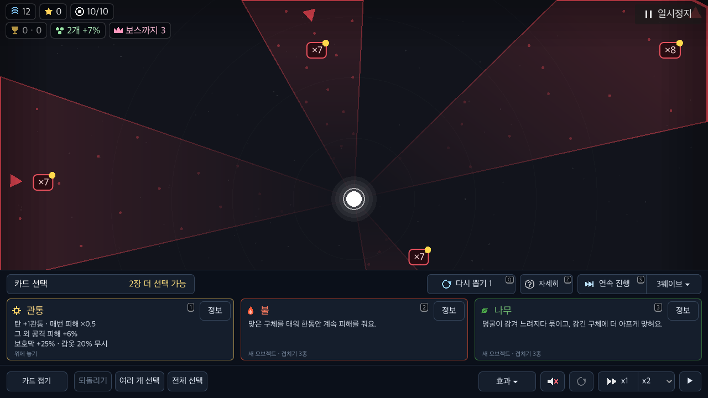

# 카드·메뉴의 접근성 이름과 설명

BF-50/UI-54 후속. 기준 `b7d01ac`, macOS/Godot4.7.2/Apple M4다. **선택한 이름·설명·동작은 확인했고 전체 접근성은 HOLD**다. 제품5개 파일에서 접근성 정보만 추가했다. 전장·카메라·배치·버튼 글자·포커스·기존 입력/소비 정책을 바꾸지 않는다. [검증 요약](summary.json), [평가 범위와 판정](audit.json).

## 재현과 수정

Godot `Button`은 글이 없고 별도 접근성 이름도 없을 때 tooltip을 이름으로 사용한다. 따라서 아이콘 버튼 전부를 이름 누락으로 분류하지 않는다. 반면 직접 그린 카드와 일부 그림 메뉴는 버튼 글·tooltip이 모두 비어 있었다. 실제 AX 트리에서도 카드 선택의3개, 일시정지의6개 버튼이 이름 없이 반환됐다.

| 규칙·심각도 | 위치 | 기준·수정 분류 | 반영 |
|---|---|---|---|
| BTN-1 critical | 일반/특성 그림 카드 | WCAG4.1.2, manual | 번호·종류·이름·화면에 표시하는 레벨을 이름으로 제공. 일반 카드는 기존 전체 설명, 특성은 기존 설명·동전 상태·실제 보유 수를 설명으로 제공 |
| BTN-1 critical | 일시정지 그림 메뉴 | WCAG4.1.2, auto | 이미 그리는 메뉴 이름을 접근성 이름으로 연결 |
| FORM-1 major | 접기·닫기, 배속·배속 선택, 설정 버튼 | WCAG1.3.1/4.1.2, manual | 기호/배율에 조작 의미를 연결. 접기/펼치기는 상태에 따라 이름 갱신 |
| FORM-1 major | 크기·모양 화살표·음량 | WCAG1.3.1/4.1.2, manual | 기존 줄 이름·이전/다음 방향을 연결. Range·선택값·그룹·콜백은 기존 동작 유지 |
| BTN-1 critical | 시작 타일 | WCAG4.1.2, auto | 기존 타일 제목을 접근성 이름으로 연결 |

위 기준은 이 UI의 문제 분류에 사용하는 참고 기준이다. WCAG 전체 적합성 판정이 아니다. manual은 내용의 뜻을 알아야 하는 변경이라는 뜻이며, 기존 실제 제목·효과·설정 구조를 검토해 반영했다. 카테고리를 임의의 대체 설명으로 추측하지 않았다.

## 실제 OS 접근성 관찰

[관찰 도구](run.py), [OS reader](read_ax.swift), [게임 관찰기](../../../../tools/battlefield_accessibility_check.gd), [교차 검사](compare.py). 실제 native Window에 제품 장면을 붙이고 `--accessibility always --accessibility-driver accesskit`로 관찰한다. 첫 안내 완료 파일·저장·bundle 이름·온라인 주소를 QA 사본에서 격리했다. 실행 중인 자식 PID와 전달된 PID가 같아야 하며 그 PID의 `AXWindows`만 읽는다. 창은 unfocusable이고 모든 ready 상태에서 focus=false였다. 커서·활성 창·개인 저장을 조작하지 않는다. VoiceOver 음성이나 실제 기기는 사용하지 않았다.

기준/현재 각각8상태(title/choose/inspector/ready/wave/pause/settings/perk)를 관찰했다. 선택한 게임 필드(phase·picks·카메라·오브젝트 위치)와 보이는 버튼의 위치·크기·글·tooltip·포커스/disabled 값은8상태 모두 같다. 실제 이미지의 byte 동일성은 주장하지 않는다. 시간에 따라 바뀌는 그림이 있고 캡처는 별도 원본으로 보존했다.

[선택 기준](baseline-09/choose-ax.json) → [현재](current-01/choose-ax.json): `카드 1. 강화 관통`, `카드 2. 속성 불`, `카드 3. 속성 나무`와 기존 전체 설명이 실제 AXTitle/AXHelp에 나왔다. [일시정지 기준](baseline-09/pause-ax.json) → [현재](current-01/pause-ax.json)는 이름 없는6개가 계속/튜토리얼/처음부터/판 끝내기/시작 화면/끄기로 바뀐다. [특성](current-01/perk-ax.json)에서는3개 특성명·설명·보유 수, 음량3줄 이름과 모양 화살표 이름도 관찰했다. 레벨2·모든 카드 조합·플랫폼의 음성 발음을 전부 검사한 결과는 아니다.

별도 [실제 AXPress](action-01/run.json), [전후 상태](action-01/choose-result.json)는 이름으로 찾은 유일한 카드 버튼을 native 접근성 API로 실행했다. PLACE/카드 들기 상태로 바뀌고 선택2회·카메라·오브젝트 위치는 유지됐다. 마우스 이벤트나 버튼 signal을 직접 주입한 성공으로 대체하지 않았다.



## 계층·가시성과 남은 범위

raw `AXChildren`에는 현재 GUI inventory에서 숨겨진 조작도 포함됐다. 창 제목의 QA 표시는 소유한 창과 상태를 식별하며 모든 자손의 최신 갱신·가시성을 증명하지 않는다. 이를 화면의 보이는 버튼 수나 VoiceOver 탐색 성공으로 합산하지 않는다. Apple도 전체 자식·선형 탐색 순서·보이는 자식 API를 구분한다. [Apple AX 계층 API](https://developer.apple.com/documentation/appkit/nsaccessibilityprotocol/accessibilitychildren%28%29).

실제 VoiceOver 탐색·음성·숨은 조작 제외·포커스 이동·스위치, 움직이는 전장 오브젝트/구체의 표현, 모든 기술 조작, 색각·대비·실기기/사람 과제는 남는다. iOS/Android 접근성 provider 지원을 이 macOS 관찰로 보장하지 않는다. 판정은 전체 HOLD이고 BF-50/원래50개 목표를 닫지 않는다.

## 회귀와 발견한 미해결 충돌

[키보드3프로필126단언](keyboard/run.json)은 기존 정보 읽기·전장 복귀·조준 경로를 확인했다. [최종 전체 검사](full-check-final.log)는 명세252·gift86·parity345사례/4140표본·fuzz4×3000의 실제 종료0·W4/8/12→13 복원·서버28 통과다. [아키텍처 감사](architecture.log)는 기존43개 중 이번에 실제 검토한2개를 제외한41개가 남으며 새 실패0이다. runtime 경계 검사0과 구분한다.

첫 [전체 검사](full-check.log)는 이전 작업24 도구가 직접 parse를 호출하여 UI-34에 실패했다. `ccee2d3`에서 공용 `VirtualInput.enqueue()`로 옮겼고 기존 `send()` 본문은 원문 그대로다. [worker canary](enqueue-preserved-send/results.json)3검사·최종 전체 검사로 확인했으며 예외나 금지 조건을 완화하지 않았다.

그 다음 [전체 검사](full-check-fixed.log)는 fuzz nominal seed2에서 한 번 메시지큐 고갈·signal11/exit134가 나왔다. [원본 SHA·첫 오류·제한](fuzz-oom.json).128,124,780바이트 원본과 원래 경로를 보존했다. 기존 send 경로를 유지한 최종 검사에서 재발하지 않았지만 **충돌 원인을 확정하거나 해결한 것으로 보고하지 않는다.** 원래 입력 시퀀스가 기록되지 않아 nominal seed만으로 동일 실행을 보장할 수 없다. 큐 메모리를 키우거나 검사 조건을 느슨하게 하지 않았다. I-15로 남기고 재현·원인 분리가 다음 우선 작업이다.

[초기 시도 제외](exclusions.json)는 첫 안내 화면 혼입, SubViewport/새 Label marker 불완전 관찰, 초기화 전 Sfx 접근, DEBUG 접미사를 고려하지 않은 marker 비교를 구분한다. 초기 앱 전체 계층에는 공유 메뉴가 들어가 최종 reader를 해당 QA 창 전용으로 제한했다. 그 초기 raw는 공개 자료에 넣지 않는다. 일부 실행의 ObjectDB2 종료 경고도 원본에 유지한다.

```sh
python3 docs/qa/2026-11-09-battlefield-fixes/accessibility/run.py --source-ref b7d01ac54685ee02e76ecd565533d9fca42562e3 --output /tmp/bindu-ax-before-new
python3 docs/qa/2026-11-09-battlefield-fixes/accessibility/run.py --output /tmp/bindu-ax-current-new
python3 docs/qa/2026-11-09-battlefield-fixes/accessibility/run.py --press-card --output /tmp/bindu-ax-action-new
python3 docs/qa/2026-11-09-battlefield-fixes/accessibility/compare.py --baseline /tmp/bindu-ax-before-new --current /tmp/bindu-ax-current-new --action /tmp/bindu-ax-action-new --output /tmp/bindu-ax-summary-new.json
```

새 output을 사용한다. 위 reader는 이미 허용된 macOS 접근성 권한이 필요하며 권한을 자동 변경하거나 VoiceOver를 켜지 않는다. 임시 프로젝트·고유 QA 저장·자식 프로세스는 각 실행 뒤 정리한다.
