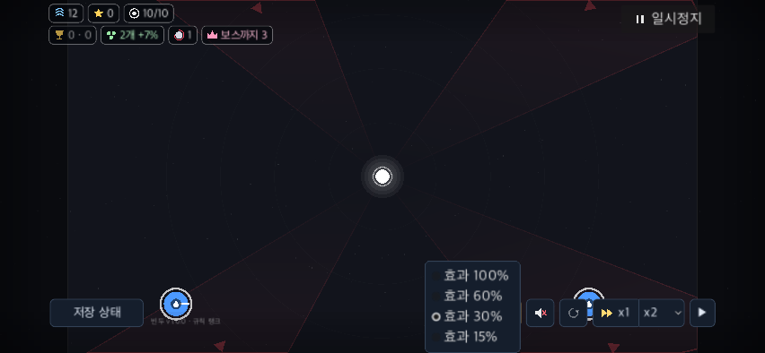
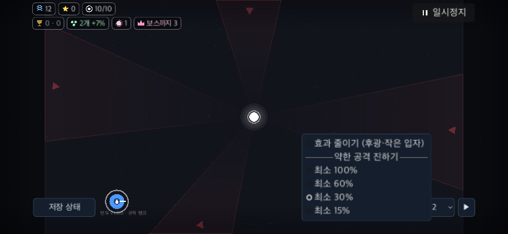
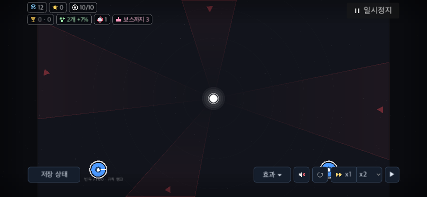
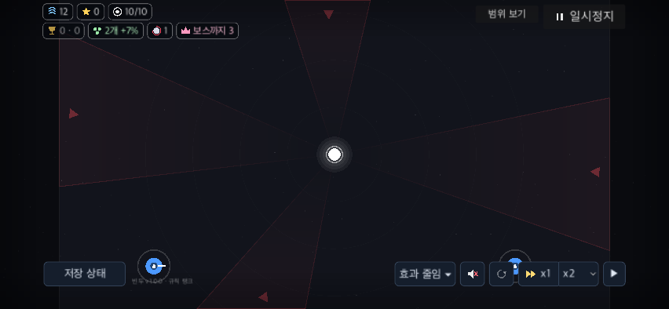

# 전장의 효과 설정 구분과 안전 영역

BF-49/UI-52 후속이다. 옵션 줄의 ‘효과 30%’는 약한 오브젝트의 탄·장판 진하기만 조절했다. 후광·작은 입자를 생략하는 ‘효과 줄이기’는 별도 설정창에 있었다. 빠른 메뉴에 두 기능을 독립 항목으로 제공하고, 줄이기 상태를 버튼·체크 표시·설정창에 함께 반영한다.

## 재현과 수정

기준은 `c150ce3`다. [기존 native 결과](baseline-verified/run.json)에서 효과15%를 실제 선택해도 `Meta.fx_low`는 false였다. 폰130% 메뉴는 논리 화면 y=720까지 내려와 UI 안전 영역 끝 y=682를38만큼 넘었다. 화면 안에 있다는 검사만으로 홈 막대 가림을 배제할 수 없었다.

기존 OptionButton 자리에 MenuButton을 사용한다. 첫 체크 항목은 후광·작은 입자 줄이기, 구분선 아래 네 라디오 항목은 약한 공격의 최소 진하기100/60/30/15%다. 둘 중 하나를 바꿔도 다른 값은 유지한다. 기본값은 장식 생략 끔·진하기30% 그대로다. 선택 후 메뉴가 닫히며 Esc는 메뉴만 닫는다.

공통 버튼 표면과 ▾ 표시를 유지한다. 설정창에서 바꾼 상태와 빠른 메뉴의 체크·버튼 글을 맞추며, 프로그램으로 스위치를 맞출 때 추가 toggled를 발생시키지 않는다. 메뉴가 실제 열린 뒤 최종 크기로 기존 UI 안전 영역 안에 위치시켜 노치·홈 막대를 피한다. 전장·카메라·배속·공격 계산·저장 키·효과 그리기 함수는 수정하지 않는다.

## 검증 범위

[최종 native 결과](product-final-native/run.json), [검사 소스](../../../../tools/battlefield_fx_controls_check.gd), [실행 도구](run_native.py).

PC1280×720·폰 모의852×393 각각 UI100/130%, 총4프로필·108단언·실패0이다. macOS Godot4.7.2 native 최소화/no_focus 창의 SubViewport에서 검증한다. 고유 BinduTools 저장과 빈 운영 URL을 사용하며, 소유한 임시 프로젝트·저장은 실행 뒤 제거한다. 실행 manifest에 제품·QA 소스 SHA-256을 기록한다.

각 프로필에서 실제 전투 상태를 유지한 채 메뉴 열기·마우스/터치 선택·네 진하기 선택·방향키 탐색/Enter·Esc·정지 화면 설정 버튼·설정 스위치·저장/복원을 검사한다. radio/check signal을 직접 emit하지 않는다. PopupMenu 행은 이동량과 속도가 있는 포인터 이벤트의 실제 hover hit-test로 찾는다. 메뉴/설정 변경 뒤 선택 횟수·8배속·WAVE·명시적 재개와 옵션 줄의 크기/위치·카메라를 확인한다.

별도 전체 `ui_check` 결과를 이 검사에 합산하지 않는다. 이 도구의 UI 검증은 메뉴의 화면/안전 영역 포함, 버튼 표면·펼침 표시, 옵션 줄·카메라 불변 단언에 한정한다. 일부 실행의 종료 ObjectDB2 경고는 runtime 오류와 구분한다.

| 폰130% 기존 메뉴 | 수정 메뉴 |
|---|---|
|  |  |

| 기본 버튼 | 줄이기 켠 버튼 |
|---|---|
|  |  |

[최종 전체 회귀](final-full-check.log)는 exit0, 명세252·전달 상태86·parity345사례/4140표본·fuzz4·W4/8/12 복원→13·서버28 통과다. [제품/증거 해시](product-verification.json), [PC 입력 로그](product-final-native/pc100/native.log), [폰 입력 로그](product-final-native/phone130/native.log). [일회성 아키텍처 감사](architecture.log)는 기존 미기록43개이며 새 미검토0, runtime 경계 검사는 전체 check에서 따로 확인한다. 이전 release·실통신·전체 UI snapshot은 그 단계의 증거로 유지하며 이번 head에서 재실행했다고 주장하지 않는다.

`baseline/`의 최초 검사에는 QA의 선언 누락, `baseline-v2/`·`baseline-final/`에는 이동량/속도0인 가상 mouse motion이 있었다. `product-native/`의 Home 키 기대도 Godot PopupMenu 탐색 계약과 달랐다. 이 실패는 제품 버그로 분류하지 않고 원본을 보존했다. `baseline-native/`·`product-final/`은 CHOOSE·안전 영역 수정 전, `product-verified/`는 최종 버튼 표면/▾ 추가 전 관찰이다. 채택 결과와 섞지 않는다.

PopupMenu가 이동량/속도0인 motion을 무시하는 근거는 [Godot4.7 원본](https://github.com/godotengine/godot/blob/4.7/scene/gui/popup_menu.cpp)의 `_input_from_window_internal`이다. QA만 실제 motion 형태로 보완했으며 제품 입력 경로는 바꾸지 않았다.

## 재실행

```sh
python3 docs/qa/2026-11-09-battlefield-fixes/fx-controls/run_native.py --output /tmp/bindu-fx-controls-before --baseline-ref c150ce3 --profiles pc100 phone130
python3 docs/qa/2026-11-09-battlefield-fixes/fx-controls/run_native.py --output /tmp/bindu-fx-controls-after
PATH=/tmp/bindu-usability-server-venv313/bin:$PATH GODOT=/Applications/Godot.app/Contents/MacOS/Godot tools/run.sh check
```

기존 출력은 덮어쓰지 않고 순차 실행한다. 실제 iOS/Android·손가락 가림·잠금/복귀·사람의 설정 발견 성공률, 고배속 전체 지연과 PERF-01은 미완료다. 기본 저강도를 강제로 켜거나 배속 정책을 바꾸지 않는다.
