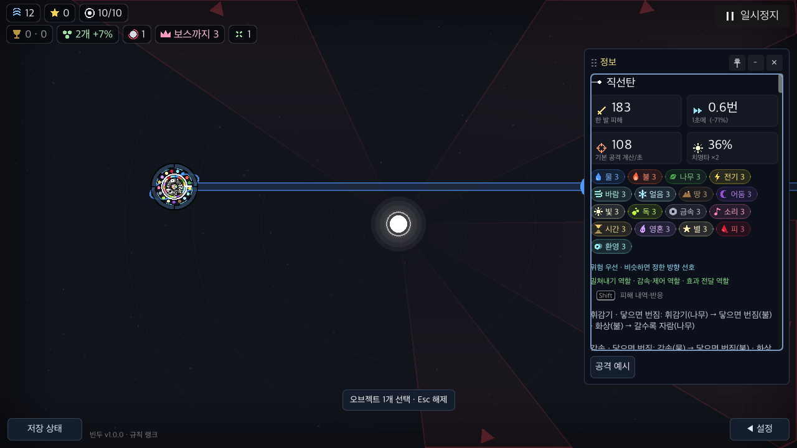
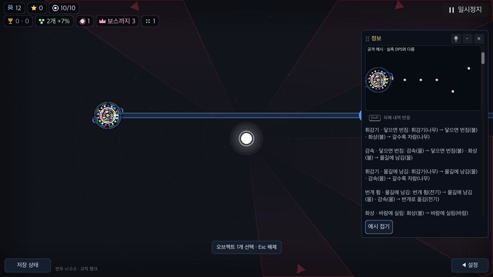
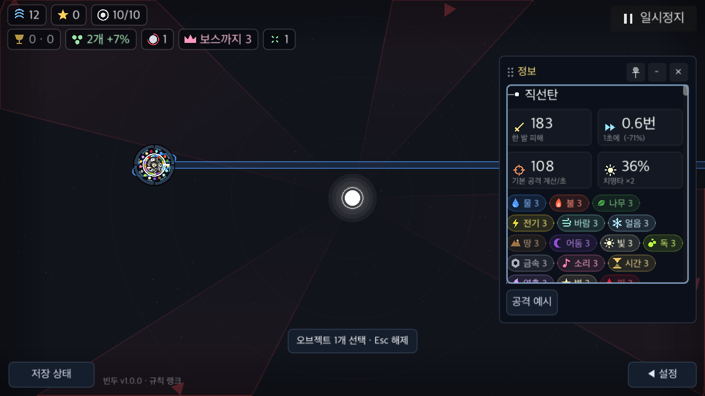
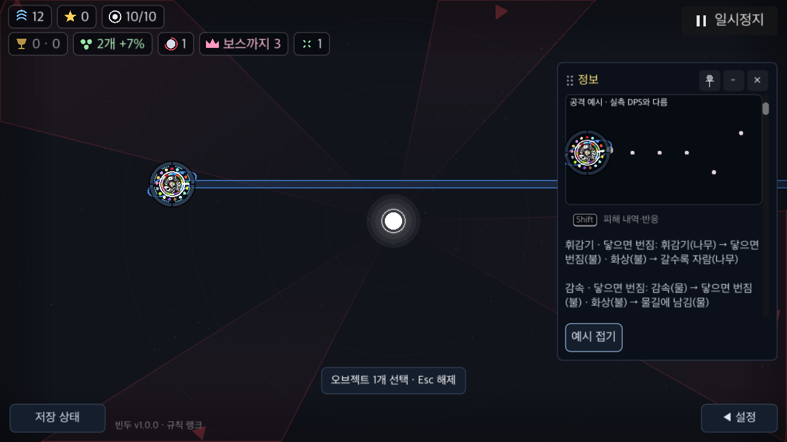
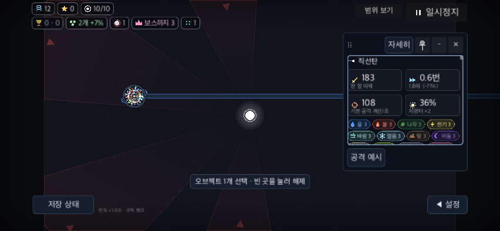
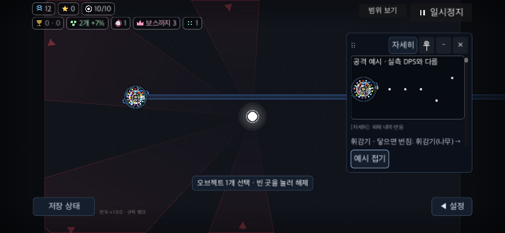

# 키보드 정보 읽기와 전장 복귀

BF-19/BF-50 후속. macOS Godot4.7.2 native 창 안의 실제 GUI key press/release를 사용한다. OS 커서·활성 창·개인 저장·서버는 격리한다. 폰은852×393 안전 영역/130% 모의 화면이며 iOS 키보드·물리 기기·스위치·스크린리더 증거가 아니다.

## 재현과 수정

- **KEY-2 / major / WCAG2.1.1 / manual** — 정보창 버튼은 포커스를 받을 수 있어도 진입 키가 없다. 수정 전 [관찰](baseline/run.json)의 각 프로필32상태에서 GUI 포커스는 계속 비었고 Tab은 대상만 순환했다. frozen `2d8c4c5`의 [음성 검사](baseline-check/run.json)는3프로필 모두 F6 카드 읽기/대상 정보 진입2개를 실패했다.
- F6으로 현재 정보창을 읽고 다시 전장으로 돌아온다. 선택 단계에 창이 없으면 현재 카드부터 소비 없이 읽는다. 창 안 Tab/Shift+Tab은 보이는 활성 버튼과 설명 칸만 순환한다. Enter/Space 실행, 설명 칸의 ↑/↓·Page Up/Down·Home/End 스크롤을 제공한다. 접힌/숨은 내용에는 포커스를 주지 않는다. 설정·읽기 모달·특성·정지는 이 진입보다 우선한다.
- 헤더 포커스 허용은 이 정보창에만 적용한다. 기존 DPS 표의 기본 포커스 정책은 유지한다. 설명 칸에는 크기/여백을 바꾸지 않는 포커스 테두리를 표시한다.
- **BF-19 방향 편집 반례** — Tab 선택→← 이동→E→↑→Enter에서 이전 포인터가 남아 `(0.707107,-0.707107)`을 확정했다. [실제 음성 기록](direction-negative/pc100/run.log). `_start_move()`에서 키보드 기준점을 초기화해 첫 방향키를 현재 오브젝트 위치에서 시작한다. 기존 마우스·터치 조준과 취소 경로는 유지한다.

[기준 관찰기](observe.gd) · [관찰 실행](run_observe.py) · [동일 GUI 검사 실행](run_check.py) · [실제 입력 검사](../../../../tools/battlefield_keyboard_check.gd).

## 채택 증거

[최종42단언×3프로필](final-scoped/run.json)과 실제 [PC100 포커스 이동](final-scoped/pc100/focus-trace.json), [PC130](final-scoped/pc130/focus-trace.json), [폰130](final-scoped/phone130/focus-trace.json). QA에서 `grab_focus()`나 버튼 signal을 직접 호출하지 않는다. 각 키의 누름/뗌이 기존 Input→GUI→unhandled 경로를 통과한다.

카드 이전/다음·들기·Esc 취소·닫기, 대상 순환·읽기 진입·스크롤·예시 전체/접기·접힌 내용 제외·전투 Esc 즉시 정지/P 재개·F6 복귀·이동/방향 확정·8개 읽기 모달/특성/정지 보호를 확인한다. 읽기 단계의 선택·위치·선택수·카메라를 보존한다. 이 성공을 전장 전체 키보드 접근성으로 확대하지 않는다.

| 설명 칸 포커스 | 예시 버튼 포커스 |
|---|---|
|  |  |
|  |  |
|  |  |

기능 성공 뒤 `final-guarded` 캡처에서 설명 칸 테두리가 보이지 않아 채택하지 않았다. Godot의 `draw_focus_border`를 켜고 여백0으로 다시 검사했다. `final-visible` 이후 정보창 밖 헤더의 포커스 정책을 보존하도록 범위를 줄인 `final-scoped`가 최종 제품이다. 앞선 실패/중간 원본은 덮어쓰지 않고 로컬 manifest에 남긴다.

[기존 정보/카드 검사](compatibility-scoped/run.json), [최종 공통 검사](full-check.log), [일회성 아키텍처 감사](architecture-audit.log), [범위·기준·미관찰 항목](audit.json), [소스/결과 요약](summary.json). 일회성 감사는 기존43개와 새0개이며 runtime 경계 검사와 구분한다.

## 남은 접근성

판정은 **HOLD**다. 선택한 정보 읽기/편집 복귀 경로의 키보드 증거만 확보했다. 실제 VoiceOver/NVDA/스위치·접근성 트리·이름/역할/상태·구체/기술의 전체 조작 경로·색각·대비 측정·실제 사람의 인지/소요 시간은 미관찰이다. [원래 사용자 과제](../remaining-user-tasks.md)를 유지한다. BF-49 고배속/PERF-01도 별도 미완료다.

재현 명령(새 빈 output 폴더 사용):

```sh
python3 docs/qa/2026-11-09-battlefield-fixes/keyboard/run_check.py --output /tmp/bindu-keyboard-new
python3 docs/qa/2026-11-09-battlefield-fixes/keyboard/run_check.py --source-ref 2d8c4c5320ff9783e2a595e1bd5e059d762666e6 --expect-failure --output /tmp/bindu-keyboard-negative-new
```
