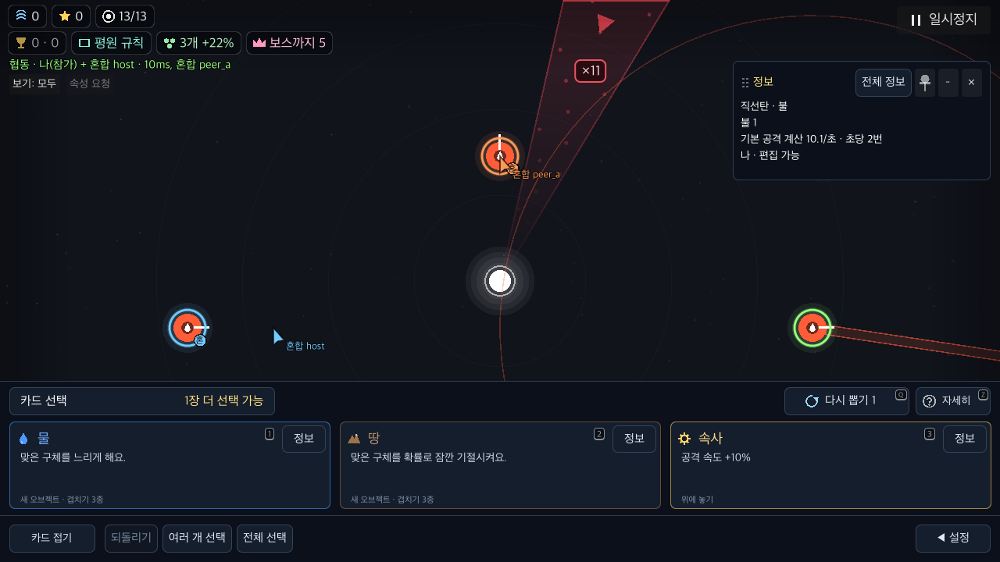
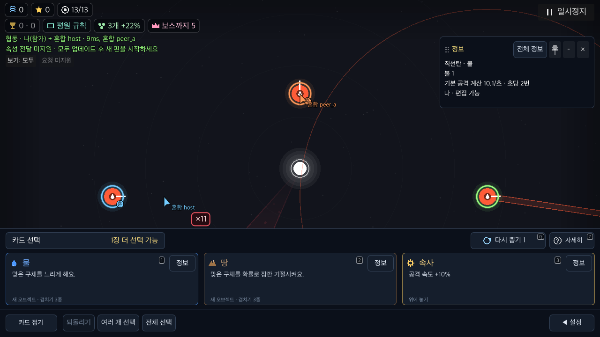

# 혼합 버전 협동의 전달 지원 안내

BF-46/UI-53 후속. 기존 main `8704b78`과 수정 전 브랜치 `3c1d7f2`, 현재 제품을 실제 native WebRTC3인 조합으로 실행한다. 같은 macOS 안의 소스 조합이며 배포된 구버전 바이너리·다른 기기·인터넷/NAT 검증은 아니다.

## 관찰과 변경

구host는 전달 프로토콜을 시작하지 않는다. 새 클라이언트끼리도 기존 plain TW 형식으로 오브젝트를 주고받아야 한다. 신규host에 구참가자가 있으면 프로토콜1을 시작해도 모든 참가자의 지원이 확인되지 않는다. 두 경우 모두 현재 앱의 선물은 차단하고 카드를 보관해야 하지만, 자기 오브젝트 편집·동기화·준비·웨이브 진행은 가능해야 한다.

기존 코드의 데이터 보호는 통과했다. 그러나 정상 연결된 구host 판에서도 버튼은 ‘속성 요청’, tooltip은 ‘친구들의 연결 확인 후 요청할 수 있어요’였다. 실제로 전달할 수 없는 상태를 일시 연결 대기처럼 보이게 했으며, 업데이트·새 판 안내는 전달을 시도해야 보였다.

제품은 지원 미확인과 미지원을 구분한다. 프로토콜이 맞지 않는 판에는 ‘요청 미지원’, 프로토콜1에서 참가자 지원이 아직 확인되지 않으면 ‘요청 확인 중’을 표시한다. 상태 줄에도 업데이트 후 새 판을 시작하는 복구 행동을 표시해 hover 없이 읽게 한다. 정상 지원 확인 후에는 ‘속성 요청’·쉬는 시간마다1장 안내로 복귀한다. 기존 pending/정산/재접속 안내는 우선하며 예약·소비·TW·배속·피해 규칙은 바꾸지 않는다.

## 실제 실행과 증거

[집계·소스·정리 결과](summary.json), [최종 전체 회귀](product-full-check.log), [도구](run_native.py), [입력 검사](../../../../../tools/battlefield_mixed_version_check.gd).

수정 전 PC3조합9actor·231단언, 현재 제품 PC3조합9actor·256단언과 폰2조합6actor·170단언을 통과했다. 현재 제품 합계15actor·426단언이며 참가자 runtime 오류0이다. 전체 회귀는 명세252·전달 상태86·parity345사례/4140표본·fuzz4·W4/8/12 복원→13·서버28 통과다. [일회성 아키텍처 감사](architecture.log)는 기존43개·새 미검토0이며 전체 감사 통과는 아니다.

- 구host + 신규 참가자2명: 구host의 실제 요청을 받되 신규 donor의 전달은 거절한다. 같은 카드는 자기 오브젝트에 정상 사용하며 전원 W1로 진행한다.
- 신규host + 구참가자1명 + 신규 참가자1명: 구참가자의 요청·TW를 읽고 전달 지원 미확인 상태를 유지한다. 거절 뒤 카드 보관·자기 편집·전원 W1 진행을 확인한다.
- 전원 신규: 지원 확인 후 실제 요청→전달→host commit→선택1회 소비→정산 해제→모든 replica 일치를 확인한다. 거절만 하는 코드가 통과하지 못하는 대조군이다.

초기 유효 카드 내용만 결정적으로 준비한다. 오브젝트 설치·요청 메뉴·속성 선택·전달 시도·취소·자기 적용·준비는 실제 Viewport 입력이다. capability·packet 수신·소비 결과는 주입하거나 직접 signal을 emit하지 않는다. 공유 파일은 방 코드·조정 barrier·각자가 관찰한 오브젝트 상태를 저장한다. 정상 선물 관찰을 모두 마친 뒤 다음 자기 카드를 써서 서로 다른 시점의 값을 비교하지 않는다.

PC/수정 전 실행의 QA는 [실제 실행본](qa-pc-frozen.gd)과 SHA가 일치한다. 폰 실행본은 가려진 구버전 대상을 실제 카드 접기 버튼으로 드러내는 경로만 추가했다. 각 실행의 제품 script SHA는 summary에 보존하며 PC/폰 모두 현재 checkout과 일치했다.

PC100%와 폰 모의130%를 구분한다. 폰은852×393 native 화면·안전 여백86/0/86/38·실제 가상 touch이며 실물 손가락 검증이 아니다. 최종 표시는 지원 상태·복구 행동·기존 요청 기능 복귀와 상태 줄/버튼의 안전 영역·세로 겹침을 따로 확인한다. 전체 화면 접근성 검사를 대체하지 않는다.

| 구host 판의 기존 대기 안내 | 수정 안내 |
|---|---|
|  |  |

폰130%의 [미지원 안내](product-phone-final/legacy_host/peer_b/capability.png)와 [지원 확인 중 안내](product-phone-final/current_host/peer_b/capability.png), 실제 [거절 뒤 정상 진행 로그](product-phone-final/current_host/peer_b.log), [전원 신규 실제 전달 로그](product-pc-controlled/all_current/peer_b.log)를 직접 확인한다.

## STUN과 실패 자료의 범위

기존 로컬 중개는 `ice: []`를 보내지만 `Mp._on_signal()`은 빈 배열을 채택하지 않는다. 기존 실행의 실제 ICE에는 기본 Cloudflare STUN이 남았고, 한 시도는 후보 연결 단계에서 종료됐다. 이를 기능 비교 통과로 사용하지 않는다. 이전 선물 README의 ‘STUN 미사용’ 주장도 정정했다.

채택 실행의 QA는 `main.mp.ice=[]`를 명시해 host 후보만 사용하고 각 참가자의 실제 ICE 배열을 결과에 기록한다. 제품 네트워크 기본값과 운영 endpoint는 바꾸지 않는다. 운영 URL은 사본에서 비우고 loopback signaling만 지정한다. 이 조건의 성공을 인터넷/NAT 성공으로 확장하지 않는다.

이전 시도는 삭제하지 않았다. 최초 `baseline/`은 Python3.9의 tar API 차이, `baseline-v2/`는 처음 열린 tutorial을 닫지 않은 QA 준비 오류다. `baseline-v3/`는 JSON으로 읽은 정수 필드의 타입 차이를 그대로 Dictionary 비교한 QA 오류다. `transport-baseline/`의 문구 검색은 한글 word-joiner를 정규화하지 않아 실패했다. `transport-verified/`와 `product-phone-controlled/`에서는 QA가 아래 카드 패널에 가린 위치를 요청 대상으로 눌렀다. `baseline-final/`의 전원 신규에서는 다른 참가자가 선물+1을 관찰하기 전에 owner가 다음 카드를 써 +2가 됐다. `before/`는 실제 ICE 연결 단계 실패다. 각각 조정·입력·관측 범위의 문제로 보존하며 제품 거래 손실로 단정하지 않는다.

로컬 WebSocket 전용 중개는 앱의 HTTP `/status` 요청에 invalid-upgrade를 남길 수 있다. signal 로그와 참가자 runtime 오류를 구분한다. 정리는 모든 행동 단언 뒤 통신 중지 barrier→transport 종료 순서이며 임시 프로젝트·고유 BinduTools 저장은 제거한다. 원자료 전체의 SHA와 공개 여부는 상위 publication manifest에 보존한다.

## 재실행

```sh
python3 docs/qa/2026-11-09-battlefield-fixes/multiplayer/mixed-version/run_native.py --output /tmp/bindu-mixed-before --current-ref 3c1d7f2
python3 docs/qa/2026-11-09-battlefield-fixes/multiplayer/mixed-version/run_native.py --output /tmp/bindu-mixed-after --verify-copy
python3 docs/qa/2026-11-09-battlefield-fixes/multiplayer/mixed-version/run_native.py --output /tmp/bindu-mixed-phone --verify-copy --profile phone130 --cohorts legacy_host current_host
```

새 출력 경로에서 순차 실행한다. 실기기·인터넷/NAT·OS kill/재실행·예약의 디스크 복구·실제 구버전 release 바이너리·사람 과제는 계속 미검증이다. BF-46과 전체50개 목표를 완료 처리하지 않는다.
