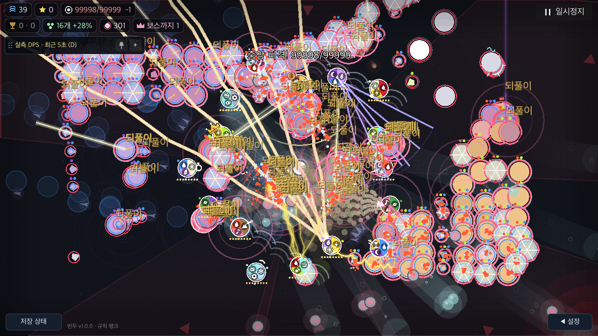

# release 실행과 메인 스레드 대기 확인

BF-49는 미완료다. 이번 단계는 개발용 실행의 함수 시간만으로 입력 응답을 판단하던 공백을 줄인다. **제품 코드·설정은 수정하지 않았다.** 기준은 `158f88f`의 Tower SHA-256 `fc9510c7d5463bf9610bb6c2acc4d57964122a4c12d0c5eaaced577df8e5764d`다.

## 실행 범위

[도구](run_export.py)는 macOS Godot4.7.2의 로컬 release 템플릿으로 격리된 QA 앱을 export한다. 제품 scripts·main.tscn·아이콘은 복사하고 운영 URL만 빈 값으로 만든다. 기본 tools 제외 규칙은 유지하며 필요한 검사 도구를 별도 qa 경로에 넣고 custom SceneTree MainLoop로 시작한다. 빈 시작 장면은 QA 진입점이다. 실제 타이틀·메뉴를 통한 시작 과제는 아니다.

원본 프로젝트·빌드 설정·버전은 그대로다. QA 앱에는 고유 BinduTools 저장 이름·bundle ID·no-focus/minimized 창·Dummy 오디오를 적용했다. 임시 앱과 고유 저장은 종료 뒤 삭제했다. [현재 설정의 export·소스/바이너리/pack 해시·정리](verified-current/run.json), [실행한 QA MainLoop](verified-current/qa-mainloop.txt), [export 로그](verified-current/export.log).

각 실행은 오브젝트16개·구체 약300개, 1/8배속·효과 전체, 고정 simulation delta1/60초·조건별 준비30/표본30이다. native SubViewport와 강제 draw 반환을 사용한다. 실기기 FPS·디스플레이 표시 완료·OS 키/터치부터 화면까지의 지연 측정은 아니다. 다른 Godot QA와 동시에 실행하지 않았다.

## 큐 대기와 처리 시간

기존 pause_probe는 VirtualInput.send 이후 정지 상태까지를 잰다. 새 검사는 worker가5ms 뒤 call_deferred로 요청을 보내고, 메인 스레드가 이를 꺼내면 기존 가상 P 입력 경로를 실행한다. 요청은 모든18표본에서 실제 simulation 계산 중 게시됐다. 요청 큐 대기와 dispatch 뒤 처리를 구분한다. 각 배속의 큐 표본은3개뿐이므로 p95나 보장값으로 읽지 않는다.

[집계](comparison.json), [editor 원자료](verified-current/editor/measurements.json), [release 원자료](verified-current/release/measurements.json), [editor 로그](verified-current/editor/native.log), [release 로그](verified-current/release/native.log).

| 실행/배속 | main CPU 평균 ms | 요청→dispatch ms,3개 범위 | dispatch→정지 상태 ms |
|---|---:|---:|---:|
| editor/1 |11.39|22.26–23.42|0.160–0.200|
| editor/8 |123.77|148.21–169.12|0.185–0.194|
| release/1 |9.61|21.35–22.17|0.123–0.197|
| release/8 |100.75|130.09–144.59|0.138–0.147|

두 실행 모두 timing runtime 오류0·행동/UI 실패0, 큐 요청6회씩의 정지 상태·메뉴 표시·재개를 확인했다. release는 `template=true/debug_build=false/editor=false`를 실제 출력으로 확인했다. 개발용 실행보다 CPU는 줄었지만 고배속 큐 대기는 남았다. 기존 약0.2ms dispatch 시간으로 전체 응답이 빠르다고 결론 내릴 수 없다.

## 스택 추적을 끄는 실험

현재 project.godot는 `debug/settings/gdscript/always_track_call_stacks=true`다. [Godot 공식 logging 문서](https://docs.godotengine.org/en/stable/tutorials/scripting/logging.html#script-backtraces)는 release 오류의 호출 경로를 남기기 위한 이 설정을 설명한다. [ProjectSettings](https://docs.godotengine.org/en/stable/classes/class_projectsettings.html#class-projectsettings-property-debug-settings-gdscript-always-track-call-stacks)는 editor/debug 실행에서는 설정과 관계없이 스택을 추적한다고 명시한다.

별도의 임시 release 사본에서만 껐다. [export/정리 기록](trace-off-experiment/run.json), [측정](trace-off-experiment/release/measurements.json), [로그](trace-off-experiment/release/native.log). main CPU는1배속8.94ms·8배속99.69ms, 큐 대기는 각각23.56–23.95ms·137.49–157.24ms였다. 단일 별도 실행이며 열 상태·그리기 변동을 제거한 인과 효과 크기는 아니다. 고배속 큐 지연 감소는 관찰하지 못했다.

각 timing 실행과 별개인 진단 프로세스에서 QA용 오류1개를 의도적으로 발생시켰다. 실제 ErrLog를 통해 root→mid→leaf 세 함수를 확인했다. [현재 release 진단](verified-current/release/diagnostic.json), [로그](verified-current/release/diagnostic.log), [추적 off 진단](trace-off-experiment/release/diagnostic.json), [로그](trace-off-experiment/release/diagnostic.log), [editor 진단](verified-current/editor/diagnostic.json).

켜면 세 스크립트 함수가 모두 남았다. 끄면 세 함수가 모두 사라지고 `core/variant/variant_utility.cpp:1023 push_error`와 빈 bt만 남았다. 이 의도적 오류는 진단 프로세스마다 정확히1개로 제한했고 timing 오류0과 구분한다. 네트워크로 보내지 않았다. **지연 이득이 확인되지 않고 오류 진단 정보는 줄어 제품 설정을 유지한다.**

## 화면에서 추가 확인한 문제

아래는 current release의 실제 캡처다. ‘되풀이’ 같은 동일한 상태 문자가 겹쳐 개체·방향·효과를 가린다. BF-49의 표시 밀도 개선 대상으로 이어간다. 피해·popup 데이터·RNG를 보존하는 렌더 단계의 중복 겹침 제거를 검토한다.



## 실패 실행 보존

- [current 제외 기록](current/exclusion.json): 빈 main_scene 때문에 QA 시작이 거절됐다. 해당 소유 프로세스를 종료했다.
- [current-fixed 제외 기록](current-fixed/exclusion.json): 실패한 이전 QA가 살아 있던 상태와 잠깐 겹쳤다. 두 소유 프로세스를 종료·종료 상태를 확인하고 표본을 모두 제외했다. 이후 프로세스가 실제 종료되기 전에는 재실행하지 않았고 driver에 배타 lock을 추가했다.
- [validated-current 제외 기록](validated-current/exclusion.json): QA가 실제 pause_box 대신 pause_menu를 참조했다. 기존 pause_probe와 대조해 고쳤고 대기는 프레임 수 대신2초 deadline으로 바꿨다. 초기화/스크립트 오류는 즉시 소유 프로세스를 종료하도록 했다.

위 원본은 로컬에 남겨 두고 채택 근거로 쓰지 않는다. 채택한 실행은 `verified-current/`와 `trace-off-experiment/`뿐이다. 일부 일반 QA 종료의 ObjectDB 경고는 로그에 남는다. import의 Android/ADB 연결 메시지는 모바일 기기 검증이 아니다.

## 재실행

```sh
python3 docs/qa/2026-11-09-battlefield-fixes/performance/export-runtime/run_export.py --output /tmp/bindu-export-current
python3 docs/qa/2026-11-09-battlefield-fixes/performance/export-runtime/run_export.py --stack off --runtimes release --output /tmp/bindu-export-stack-off
```

기존 관찰을 덮어쓰지 않도록 새 출력 경로가 필요하다. export 템플릿·code signing은 로컬 ad-hoc 동작이며 store 배포가 아니다. 실제 iOS/Android·사람 과제·인터넷/NAT·OS 종료 검증은 여전히 남는다.
