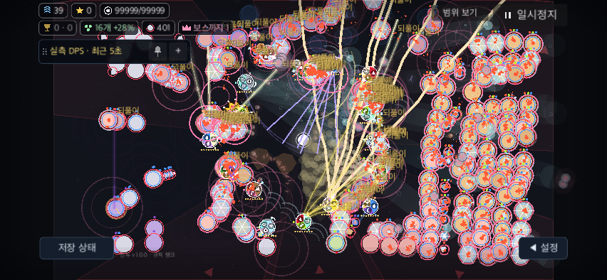
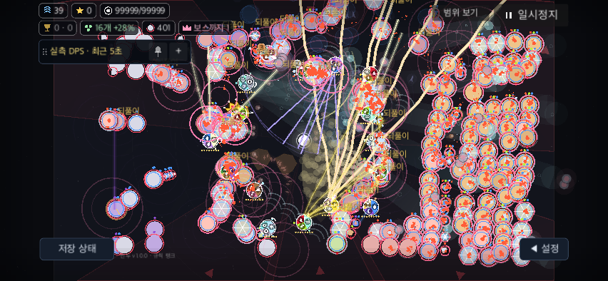

# 같은 상태 문구의 겹침 줄이기

BF-49의 표시 밀도 수정이다. 고배속 계산·입력 큐 지연과 PERF-01은 미완료다. 개체·효과 자체의 혼잡도 남는다. 원본 popup을 삭제·합산하거나 발생 빈도·피해·수명·카메라·밸런스를 바꾸지 않는다.

## 동작

화면상 글꼴 경계가 겹치는 **같은 문구·색·크기** 중 최신 것만 그린다. 피해 숫자와 서로 다른 상태/스타일은 모두 유지한다. 원래 painter 순서와 popup 저장소를 보존한다. 그림자 여백은 화면 좌표2px이며 전장 배율을 바꾸지 않는다. 미리보기에도 같은 FX 좌표 변환을 사용한다.

중복 문구가 없으면 원본 배열을 바로 반환한다. 중복은 화면128×64px 칸을 공유하는 글자 경계만 비교한다. 칸 크기는 후보 선별만 바꾸며 마지막 겹침 판정은 실제 글자 경계로 한다. 긴 문구·음수 좌표·칸 경계·서로 다른 스타일도 전수 비교 참조와 같은 결과여야 한다. 매 draw의 지역 자료만 사용하고 세션 상태나 구독은 추가하지 않는다.

## 검증 범위

[집계·최종 제품 해시](summary.json). `tools/battlefield_feedback_check.gd`는 PC1280×720·폰 모의852×393, UI100/130%, 오브젝트16개·구체400개 유지 목표·8배속·고정 delta1/60의 격리 native SubViewport 검사다. 운영 URL은 비우고 고유 BinduTools 저장을 지운다. 실제 폰·손가락·OS 입력·디스플레이 지연 증거가 아니다.

30개 기본 글꼴/변환 사례와72개 혼합 문구 장면의 전수 비교 참조로 최신 표시·숫자·스타일·긴 경계·원본·후속 RNG를 검사한다. 문구 아래 구체 pointer 선택·P 정지/재개도 실행한다. 최종 소스4프로필은 각각221개, 총884개 단언 통과다. 원본121개는 PC100/130%에서26/25개, 폰100/130%에서28/25개로 그렸고 동일 스타일 겹침은 모두0이었다. 원본 배열은121개 그대로다. 마지막 live 구체는400개이며60프레임의 실제 대상 평균은399.83–399.95개였다. [명령·해시·정리](native-final/run.json).

동일 정지 장면 비교는 별도 임시 사본에 passthrough·실제 popup 그리기 콜백 count/CPU/다음 RNG 계측만 삽입한다. 삽입 코드를 제거하면 제품 소스와 byte 단위로 일치함을 driver가 검사한다. 두 idle frame 뒤 강제 draw를 하고, 매 표본 실제 콜백1회·PNG 차이·원본 popup/전투/카메라·후속 RNG를 확인한다. PC·폰 각각872개 단언, 총1,744개 통과다. 실제 그리기 콜백은 각각642회다. [명령·제품/계측 해시·정리](matched-final/run.json), [PC 원자료](matched-final/pc100/draw-benchmark.json), [폰 원자료](matched-final/phone130/draw-benchmark.json). 번갈아7묶음×10회, live·흩어진 동일 문구121개·서로 다른121개·숫자121개를 비교한다. popup 선택+draw_string 명령 등록 CPU이며 전체 프레임/물리 FPS가 아니다.

최종 release 검사는 로컬 ad-hoc macOS export의 실제 `template=true/debug_build=false/editor=false`를 확인한다. 사전 제품 소스 SHA와 export pack SHA를 기록한다. export된 스크립트는 remap되므로 원래 res 소스 파일의 FileAccess SHA와 일치한다고 주장하지 않는다. 원본 프로젝트·배포·버전·개인 저장은 변경하지 않는다.

release의 PC100/폰130%도 각각221개, 총442개 단언 통과다. 원본121개→25/26개·동일 스타일 겹침0, runtime/행동/UI 오류0이다. [export·제품/pack 해시·기능 플래그·정리](release-verified/run.json), [폰 release 캡처](release-verified/phone130/dense.png).

## 성능 해석

초기 전수 비교 후보는 흩어진121개 상태 문구의 popup CPU가 PC0.1623→1.1323ms로 증가했다. 이 측정 때문에 중복 없는 경우의 즉시 반환과 화면 칸 선별로 수정했다. 이 후보는 최종 제품 성능의 근거가 아니다. [초기 콜백 계측](matched-callback-verified/pc100/draw-benchmark.json).

그보다 앞선 [전체 전투 순차 비교](perf400/run.json)는 각각6조건·360표본·정지6회, 행동/UI/runtime 오류0이다. 실제400구체를 유지했지만 별도 실행의 render CPU는−0.28~+7.65%, main CPU는−2.99~+1.26%로 변동했다. 공격 CPU도 차이가 있어 렌더 변경의 인과 효과로 단정하지 않는다. 이 역시 최종 화면 칸 후보의 측정이 아니다. 일부 증가를 숨기거나 임의 허용 오차를 도입해 PERF-01을 통과 처리하지 않는다.

최종 화면 칸 후보의 popup 선택+그리기 명령 CPU 중앙값은 다음과 같다. 수치는7개 묶음 평균의 중앙값이다. 모든 장면의 이후 RNG는 동일했다. 추가 비용이 남으므로 전체 프레임 무회귀나 FPS 개선을 주장하지 않는다.

| 장면121개 | PC 원래/선택 ms | 폰 원래/선택 ms |
|---|---:|---:|
| 실제 겹침 |0.1748 / 0.2214|0.1768 / 0.2288|
| 흩어진 같은 문구 |0.1660 / 0.4261|0.1675 / 0.4452|
| 서로 다른 문구 |0.6371 / 0.6671|0.6316 / 0.6695|
| 숫자 |0.5341 / 0.5377|0.5282 / 0.5320|

아래는 같은 정지 장면의 실제 콜백으로 그린 폰130% 캡처다. 임시 passthrough와 선택 적용의 차이이며 제품 전체를 서로 다른 타이밍으로 실행한 그림이 아니다.

| 원래 표시 | 같은 상태 겹침 정리 |
|---|---|
|  |  |

## 제외·보존한 실행

- [동기 force_draw 검사](matched/exclusion.json): 예약된 CanvasItem 재그리기 미처리. 두 PNG가 같아 시간 비교와 동일 장면 증거에서 제외했다.
- [frame_post_draw 대기](matched-verified/exclusion.json): minimized 창의 render signal 대기 정체. 소유 프로세스를 종료한 뒤 idle frame+실제 콜백 확인으로 교체했다.
- [초기 release driver](release/exclusion.json): native 행동은 통과했지만 remap된 소스 파일 SHA를 잘못 요구해 driver가 실패했다. 사전 소스·pack 해시와 runtime 기능 플래그를 분리했다.

실패 원본은 로컬에 보존한다. 채택한 실행의 runtime 오류0과 일반 도구의 종료 ObjectDB 경고를 구분한다.

## 공통 회귀

[최종 전체 check](full-check.log): 명세252·전달 상태86·parity345사례/4140표본·fuzz4·W4/8/12 복원→13·서버28 통과. 최종 FieldView SHA는 모든 채택한 native·계측 사전 제품·release 사전 소스에서 일치한다. [일회성 아키텍처 감사](architecture.log)는 기존43개 미기록 변화가 남지만 이전 전달 대비 새 항목0이다. 전체 감사 통과로 쓰지 않는다.

## 재실행

```sh
python3 docs/qa/2026-11-09-battlefield-fixes/performance/feedback-density/run_native.py --output /tmp/bindu-feedback-final
python3 docs/qa/2026-11-09-battlefield-fixes/performance/feedback-density/run_draw.py --output /tmp/bindu-feedback-matched
python3 docs/qa/2026-11-09-battlefield-fixes/performance/feedback-density/run_release.py --output /tmp/bindu-feedback-release
```

새 출력 경로를 사용하고 Godot QA·성능 측정을 서로 겹치지 않는다. 초기 후보·실패 자료와 최종 제품 해시를 혼동하지 않는다. 실제 사용자의 식별 성공률·중급 폰 부하·색각/대비·스크린리더 과제는 [남은 검증](../../remaining-user-tasks.md)에 유지한다.
