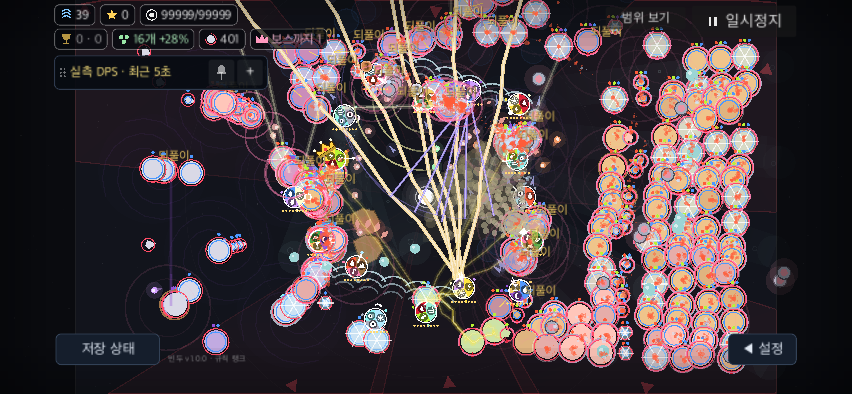

# 효과 줄이기의 장식 밀도와 그리기 비용

BF-49/UI-51 후속이다. 저강도 모드에서 빛줄기 후광·보조 고리·작은 장식 입자를 생략한다. 공격 경로·피해 문자·기술 표식·적 몸체/체력/저항/보호막/상태는 유지한다. 전장·카메라·판정·배속·입자 원본/수명은 바꾸지 않는다. 기본 설정은 그대로 끔이다. 실기기·사용자 판독 과제·고배속 전체 지연·PERF-01은 미완료다.

## 관찰과 수정

기준은 `fcfb68b`다. [원래 장면 계측](baseline/run.json), [primitive·callback 원자료](baseline/pc100/fx-profile.json)에서 FX 계층의 명령은 기본/기존 저강도 모두4,452개였다. 실제400구체·16오브젝트를 생성한 후 전투를 정지하고 모든 노드를 다시 그렸다. Orb는5,032개, 발사체717개, 장판532개였다. 계수 wrapper의 CPU 비용이 포함돼 위치 확인 자료로만 사용한다. [계측 도구](run_profile.py).

상당수는 장식 입자다. `burst()`의600 조건은 총량 상한이 아니라 이후 burst당 개수만3개로 낮춘다. 8배속의 측정 장면에는 실제 생성된 입자가 약4천개 남았다. fixture에 입자를 임의로 더해 만든 수치가 아니다.

수정은 `_draw_fx` 안에 한정한다. 저강도일 때 음파의 안쪽 보조 고리·beam/bolt의 후광·bolt 흰 보조선/끝 장식 원을 빼고 중심 경로는 그린다. 입자는 원래 크기3.5 이상만 그린다. 크기는 생성 때 고정되므로 배열 인덱스가 바뀌어도 표시 집합이 흔들리지 않는다. 기본 모드는 입자마다 조건을 검사하지 않도록 별도 루프를 사용한다. 기존 알파·장판 처리와 저장 키는 유지한다. 설정 문구는 ‘후광·작은 입자 줄임’으로 맞췄다.

## 같은 장면의 의미·RNG 검사

[동결 후보 검사](contract-final/run.json), [현재 제품 검사](product-contract/run.json), [도구](run_compare.py), [native 검사](../../../../../tools/battlefield_fx_compare_check.gd).

같은 native SubViewport·같은 정지 전장에 원래/수정 FX callback 본문을 함께 넣고 번갈아 호출한다. 실제 callback1회를 확인하며, 각 draw 전 seed9222를 사용한다. particle/popup/beam/bolt/pulse 원본과 관측한 전투 snapshot·위치·카메라, 후속 RNG를 비교한다. snapshot 필드는 검사 소스에 명시돼 있으며 모든 runtime field의 bit 비교는 아니다. 실제 폰·손가락·물리 OS 입력을 대신하지 않는다.

contract는 FieldView가 직접 호출하는 native FX 명령의 인자·순서를 추적한다. 기본 모드는 전체 trace가 동일하다. 저강도는6개 장식 명령 종류를 제외한 trace가 동일하다. 다른 helper·Orb/Projectile/Zone/Tower 코드는 수정하지 않는다. 모든 명령 trace를 넣은 실행은 시간 측정에 쓰지 않는다. 렌더 스케줄도 바꾸지 않아, 비교는 같은 draw 호출 순서에 대한 RNG 보존이다.

| 동결 후보의 장면 | 기본 모드 원래/수정 명령 | 저강도 원래/수정 명령 |
|---|---:|---:|
| PC100% |4,472 / 4,472|4,472 / 1,754|
| 폰 모의130% |4,228 / 4,228|4,228 / 1,700|

기본/저강도 두 모드 모두 인자·순서·보호한 표시·snapshot·카메라·후속 RNG 검사 실패0이다. 제품 코드를 읽는 `--product`도 같은 계약을 통과했다. 초기 `contract-smoke/`는 redraw 갱신 후보가 함께 있었던 탐색용이며 최종 제품 동일성 근거로 사용하지 않는다.

## 그리기 시간

[최종 비교](benchmark-final/run.json)는 trace를 넣지 않고 FX callback당 timer/counter 하나만 둔다. 두 idle frame 후 강제 draw를 하며 실제 callback1회를 확인한다. 전환마다6draw 준비, 선후 교대7묶음×각5표본이다. PC1280×720·폰 모의852×393, 고유 저장·no-focus/minimized·Dummy 오디오·macOS Godot4.7.2다. FX DPS 필터는0으로 고정해 quality 차이만 비교한다.

아래는7개 묶음 평균의 중앙값, 단위ms다. 반환 시간은 redraw 예약→두 idle frame→`RenderingServer.force_draw()` 반환이며 실제 디스플레이 표시 완료나 FPS가 아니다. 모든 전장 노드를 강제로 다시 그린 정지 장면이므로 실제 실행 전체 프레임 개선률로 환산하지 않는다.

| 화면/모드 | FX callback 원래/수정 | draw 반환 원래/수정 |
|---|---:|---:|
| PC 기본 |15.653 / 15.674|140.896 / 140.137|
| PC 저강도 |15.342 / 6.514|137.848 / 94.094|
| 폰 기본 |14.729 / 14.439|137.736 / 137.264|
| 폰 저강도 |14.334 / 6.124|135.422 / 93.417|

저강도 callback은약57%, 측정한 draw 반환은약31% 감소했다. 기본 PC callback의0.021ms 증가도 보존하며 임의 허용 오차로 PERF-01을 통과 처리하지 않는다. native 매칭에서 후속 RNG 시퀀스는 모두 동일했다.

`viewport_get_measured_render_time_cpu` 원자료는 variant 전환 후에도 high/low 값이 교대로 밀려 나타났다. 비동기 조회가 다른 draw 값과 섞일 가능성이 있어 개선/악화의 인과 근거에서 제외했다. `benchmark/`의 이 수치는 채택하지 않는다. 최종 파일에도 진단용 원자료로 남겼지만 callback의 즉시 timer와 단조 시계 반환 시간만 표에 사용했다. GPU 지연이나 물리 입력 응답을 측정했다고 주장하지 않는다.

## 제품·release 확인

최종 제품 해시와 원본/계측/실제 export의 구분은 [제품 검증](product-verification.json)을 따른다. [export 직전 소스](product-release/source-before-export.json), [저강도 QA 설정](product-release/qa-mode.json), [macOS release 실행](product-release/run.json). 실제 template=true/debug_build=false/editor=false이며 저강도 모드를 켜서 PC100/폰130% 각각221개 단언·행동/UI/runtime 오류0을 확인했다. export remap 뒤 원래 res 소스의 runtime SHA를 주장하지 않는다.

[제품 반영 뒤 전체 check](product-full-check.log)는 명세252·전달 상태86·parity345사례/4140표본·fuzz4·W4/8/12 복원→13·서버28 통과다. [일회성 아키텍처 감사](architecture.log)는 기존43개가 남고 새 미검토0이며 전체 감사 통과가 아니다. 일부 일반 QA의 종료 ObjectDB2 경고는 runtime 오류0과 별개다. 운영 URL은 격리 사본에서 비웠고 개인 저장·운영 서버·버전·배포는 변경하지 않았다. 소유한 임시 프로젝트·고유 저장을 종료 뒤 지웠다.

아래는 현재 제품 함수를 사용한 같은 정지 장면의 저강도 전후다. 개체·상태 표시 자체의 높은 밀도는 남는다.

| 원래 저강도 | 장식 생략 적용 |
|---|---|
|  |  |

## 재실행

```sh
python3 docs/qa/2026-11-09-battlefield-fixes/performance/fx-quality/run_compare.py --product --mode contract --output /tmp/bindu-fx-contract
python3 docs/qa/2026-11-09-battlefield-fixes/performance/fx-quality/run_compare.py --product --mode benchmark --output /tmp/bindu-fx-benchmark
python3 docs/qa/2026-11-09-battlefield-fixes/performance/fx-quality/run_release.py --output /tmp/bindu-fx-release
```

기존 결과를 덮어쓰지 않는 새 출력 경로에서 순차 실행한다. 비교 도구는 변경 범위를 FX callback으로 제한하며 그 밖의 FieldView가 달라지면 새 기준을 요구한다. 실제 사용자 판독 성공률·손가락 가림·실기기 부하·접근성은 [남은 과제](../../remaining-user-tasks.md)에 유지한다.
