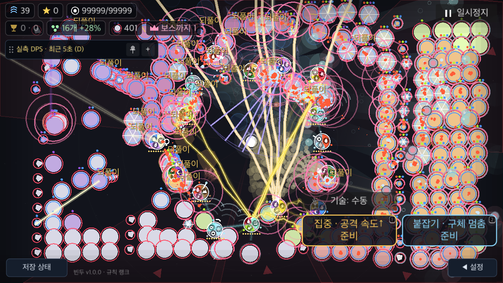
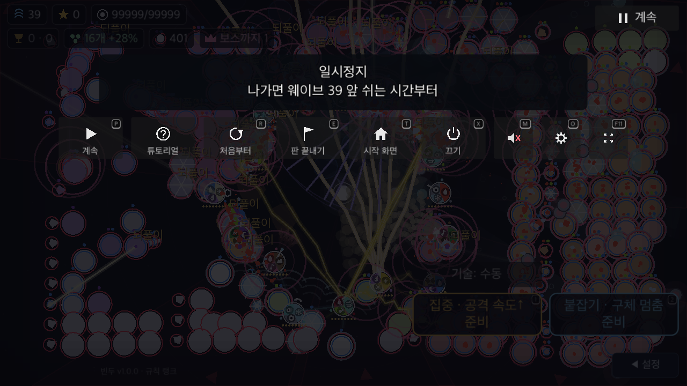

# 계산 조각 사이 입력 처리 실험

BF-49 후속. 기준 제품은 `524286d`다. **시제품만 검증하며 제품에는 채택하지 않는다.** 70개 제품 스크립트는 그대로다. 새 도구와 증거를 커밋하며 BF-49/PERF-01 및 전체50개는 미완료로 유지한다. [최종 판정](summary.json).

## 가설과 판정

기존8배속은 한 프레임에서8조각을 동기 계산한다. 이미 버퍼에 들어온 정지 요청도 그 뒤에 처리된다. [시제품](candidate.py)은 기존 조각 사이 `DisplayServer.process_events()`를 호출한다. 입력이 없으면 같은8조각과 dt를 실행한다. 정지·읽기·배속/조준 배율·run/wave/phase 변경 때만 남은 이전 조각을 중단하며 재개 시 계산 부채를 추가하지 않는다. 기존 읽기 정책의 도움말·설정·기록·패치노트만 사용하며, 소리 팝업 등 모든 모달로 중단 조건을 확대하지 않는다.

입력 콜백은 세션을 즉시 삭제할 수 있다. pump 뒤 유효성·삭제 예약·트리 소속부터 확인한다. 계산 중 `_process` 재진입도 별도 guard로 막는다. 제품의 배속 상한·기본값·시간 정책·카메라·전장·전투 공식을 수정하지 않는다. 이 실험의 명시적 사용자 입력에 따른 중단 정책을 제품에 승인된 정책으로 간주하지 않는다.

계측 계약은 [실행 도구](run.py)에 들어 있다. 숫자 허용치와 응답시간 CI budget은 합의되지 않았다. 임의의 허용치를 만들어 통과 처리하지 않는다. 상태/RNG/시간 동일성, 실제 계산 중 게시, 상태 변경·재진입·삭제 검사를 성능 수치와 구분한다.

## 제어한 native ABBA

[검증 집계](compact.json), [교차 검사](compare.py). macOS/Godot4.7.2/Apple M4의 no-focus/minimized SubViewport다.16오브젝트·400live 유지 목표·8배속·효과 전체/줄이기, 조건마다 새 세션·준비30프레임·표본30프레임을 사용했다. QA 사운드만 mute하여 벽시계 난수 소비를 제거한다. 제품 사운드를 바꾸지 않았다.

두 연속 명령의 순서가 A/B/B/A이고 실제 harness SHA가 같다.4프로세스×2조건×30표본=240 CPU 표본이다. 조건별240조각/게임4초, 구체·탄·장판 수 시퀀스,10프레임마다 선택한 전투 상태·지연 타이머·거울 값, 다음 global RNG가4실행 모두 같아야 비교를 채택한다. 모든 runtime field의 bitwise 증명은 아니다. 새 세션 덕분에7개 입력 시험의 시작 상태/RNG도 모두 비교한다.

| 효과 조건 | 기준 main CPU 평균 | 후보 평균 | 관찰 차이 |
|---|---:|---:|---:|
| 전체 |128.956ms|129.338ms|+0.30%|
| 줄이기 |129.129ms|129.368ms|+0.19%|

CPU 처리량을 개선하는 후보는 아니다. 작은 증가를 숨기거나 합의되지 않은 budget 통과로 바꾸지 않는다.

구체400은 live 유지 수다. 실제 표적 가능 수를 매 표본 집계하지 않았다. WAVE를 유지하려고 미출현1개를 남겨 HUD에는401로 표시된다.

## 합성 버퍼 요청과 화면 반영

worker가5ms 뒤 thread-safe `Input.parse_input_event()`로 새 Key press/release 객체를 버퍼에 넣는다. 태그가 있는 입력만 실제 SubViewport 입력 경로로 전달한다. OS 커서·포커스·물리 키보드·UIKit 터치를 주입하지 않는다. parse 전/후 시각을 기록하고 **parse 완료가 실제 계산 종료 전인 경우만** 채택한다. 이전 `call_deferred` 큐 실험과 요청 출처가 다르므로 두 실행의 수치를 직접 전후 비교하지 않는다.

4프로세스의 총28요청은 정지3회·설정·배속·재진입·즉시 세션 삭제다. 정지의 dispatch·SceneTree pause 알림·메뉴 visibility 알림 시각을 각각 기록한다. 메뉴 노드가 visible인 것과 화면에 표시된 것은 다르다. 작은 표본의 최솟값/최댓값만 보고하며 p95나 실제 사용자 입력 지연을 주장하지 않는다.

정지 각6표본의 버퍼 게시→dispatch는 기준113.899–154.495ms, 후보6.782–12.405ms다. 후보는1–3조각 뒤 정지했고 재개는8조각/게임0.133333초로 누적 부채가 없었다. 설정·배속 변경도 남은 이전 조각을 중단했다. 재진입은 추가 계산0, 즉시 삭제 후 엔진2프레임까지 runtime 오류0이다. 이28요청은 모두 실제 parse 완료가 계산 도중임을 확인했다.

첫 즉시 force-draw 캡처에는 visible 메뉴가 아직 그려지지 않았다. 명시적으로 paused UI를 배치하고 force-draw한 것만으로도 화면 반영 증명이 되지 않았다. 별도 [렌더 후속](render-followup/compact.json), [도구](run_render.py)는 실제 엔진 `process_frame` 경계2개 뒤 캡처를 남긴다. 이 결과도 정확한 첫 표시 프레임·GPU 완료·물리 디스플레이 시각은 아니다. 상태 변경 뒤 그리기 갱신이 남는다는 사실을 숨기지 않는다.

별도 후속의 기준/후보 시작 상태·다음 RNG는 같다. 후보의 즉시 캡처는 메뉴가 없고, 기준의 즉시 캡처는 이전 배치의 메뉴와 아직 없는 배경 어둡게 하기가 보였다.2엔진 프레임 뒤에는 양쪽 모두 제목·버튼·어두운 배경을 직접 확인했다. 이때 게시→캡처 draw 반환은 기준310.571ms/후보194.535ms의 각1표본이다.2프레임 대기·명시적 배치·캡처 비용을 포함하므로 첫 화면 표시 지연이나 일반 개선률로 해석하지 않는다.

후보의 즉시 캡처:



후보의 실제 엔진 프레임 후속:



[기준 즉시 캡처](render-followup/baseline/immediate.png), [기준2프레임 뒤](render-followup/baseline/after-two-engine-frames.png), [후보 즉시 캡처](render-followup/candidate/immediate.png).

## 모바일 적용을 보류하는 이유

[정확한 엔진 소스 검사](engine-inspection.json)는 native 실행과 같은 `ed1daf0bf001b61586d9930840f2f1394092c079`를 사용한다. macOS의 `process_events()`는 Cocoa 큐를 돌리지만 iOS/Android 구현은 이미 들어온 Input 버퍼만 비운다. iOS `drawView`는 CADisplayLink 콜백에서 UIKit run loop를 먼저 처리한 뒤 동기 `Main::iteration()`으로 들어간다. 계산 중 스크립트 pump가 새 UIKit 터치를 가져온다는 증거가 없다.

따라서 합성 버퍼 대기가 짧아져도 모바일의 손가락→UIKit→게임→화면 경로가 해결됐다고 볼 수 없다. 일반 선택·호버 등 계산 중단 조건에 없는 행동은 남은 계산이 끝난 뒤 화면에 반영될 수 있다. 재진입 한 경로와 즉시 삭제를 통과해도 모든 창 이벤트·멀티플레이·장면 전환의 안전성을 증명하지 않는다. CPU 비용과 플랫폼 차이를 포함해 제품 적용은 보류한다.

다음 구조 실험은 실제 OS 입력을 받는 엔진 프레임 경계로 돌아가는 방식을 검토해야 한다. 요청한 배속·게임 시간·누적 계산 부채와 전투/RNG 정책을 먼저 명시해야 하며, 무조건적인 조각 생략이나 임의 CPU 시간 제한으로 대체하지 않는다. BF-50 접근성과 실기기·사람 과제도 별도로 남는다.

## 실패 원본과 재현

[제외 기록](exclusions.json)에 초기 실패와 원본 SHA를 남긴다. 첫 시도는 QA가 없는 Tower 필드 `delayed`를 읽어 runtime 오류로 중단했다. 실제 `later`의 남은 타이머를 읽도록 수정했다. 다음 시도는 앞 시험의 세션 상태를 재사용해 배속 시험 이후 시작 상태가 달라 교차 검사에서 실패했다. 비교 조건을 완화하지 않고 조건마다 새 세션을 만들어 재실행했다. 두 실패의 원자료는 로컬에 보존하고 최종 수치에 합산하지 않는다.

일부 실행의 기존 ObjectDB2 종료 경고도 원본에 남긴다. runtime 오류와 혼동하지 않는다. compact는 원본 SHA·명령·70개 제품 및 harness SHA·모든 큐 표본·선택 상태/전투량 SHA를 보존한다. 큰 raw 상태를 덮어쓰거나 삭제하지 않는다. 각 임시 프로젝트와 고유 BinduTools 저장만 실행 뒤 제거한다.

상속된 `ui` 카운터는0이지만 이번 도구는 전체 `ui_check`를 실행하지 않았다. 정지 라벨/메뉴의 화면 내 포함·상호 겹침 검사와 위 선택 캡처 관찰만 했다. 이를 전체 UI 회귀 통과로 해석하지 않는다. 제품70개 SHA는 이전 전체 검사 통과 상태와 같다. 제품을 수정하지 않은 이번 증거 작업에서는 공통 전체 검사를 재실행하지 않았다.

```sh
python3 docs/qa/2026-11-09-battlefield-fixes/performance/input-service/run.py --output /tmp/bindu-input-ab-new --variants baseline candidate
python3 docs/qa/2026-11-09-battlefield-fixes/performance/input-service/run.py --output /tmp/bindu-input-ba-new --variants candidate baseline
python3 docs/qa/2026-11-09-battlefield-fixes/performance/input-service/compare.py --runs /tmp/bindu-input-ab-new /tmp/bindu-input-ba-new --output /tmp/bindu-input-compact-new.json
python3 docs/qa/2026-11-09-battlefield-fixes/performance/input-service/run_render.py --output /tmp/bindu-input-render-new
```

새 output을 사용하며 성능 실행끼리 겹치지 않는다. [검사 구현](../../../../../tools/battlefield_input_service_check.gd)과 [화면 후속](../../../../../tools/battlefield_input_render_check.gd)은 반드시 저장/서버를 격리하는 위 runner로 실행한다.

후속 전체 회귀에서 이 시제품 도구의 직접 `Input.parse_input_event()` 호출이 UI-34 공용 입력 경로 규칙에 걸렸다. 테스트 예외를 추가하지 않고 buffer-only API를 `VirtualInput.enqueue()`로 모았다. 기존 `VirtualInput.send()` 본문은 이전 커밋과 byte 단위로 같다. [worker canary](../../accessibility/enqueue-preserved-send/results.json)는 main flush 전 미전달·새 press/release4개 순서·최종 key release를 확인했다. [재현 도구](../../accessibility/run_enqueue.py). 위 ABBA 수치는 당시 동결 관찰 결과이며 이 보정을 새 성능 측정으로 합산하지 않는다.
