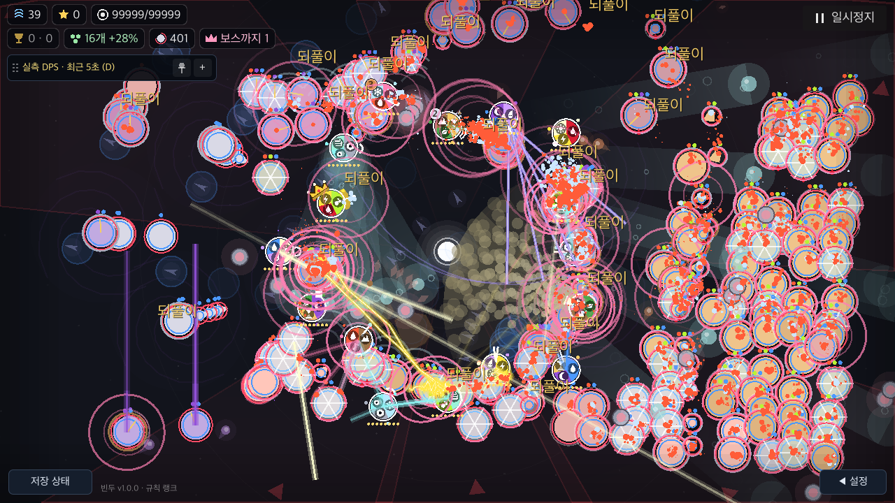

# 없는 지속·성장 효과의 반복 호출 생략

BF-49 후속. 기준 `b2da5e1`, Godot4.7.2/macOS/Apple M4다. 제품 변경은 `Tower.hit()`와 `Share.apply()`에서 이미 읽은 속성 목록에 얼음/나무가 없을 때 결과가1인 지속/성장 helper 호출을 생략한다. 배속·시뮬레이션 조각·피해·사거리·공격 순서·본 전장 카메라·제품 사운드 정책은 바꾸지 않는다. 최종 채택 상태와 남은 범위는 [요약](summary.json)을 따른다.

[계측 시작 계획](plan.json)은 제품 수정 전 기록이다.

## 먼저 확인한 비용과 거절한 후보

[현재 장판 적용](current-profile/run.json), [Share 세부](share-profile/run.json), [속성 읽기](effect-read-profile/run.json), [타격 단계](hit-phase-verified/run.json). 동일한16오브젝트/400구체 유지 목표·8배속/전체 효과에서 계측했다. 함수별 수치는 inclusive이며 wrapper bookkeeping과 재귀/중첩이 있어 합산하지 않는다. 각 계측은 벽시계 사운드/RNG 때문에 실제 전투량도 달라진다. 이 네 실행을 전후 개선률로 비교하지 않는다.

속성 세기 조회는 한 세부 계측에서1,288,461회 중987,458회가0이었다. 별도 읽기 계측의 `_els()`는2,678,200회였다. 타격 단계에서는 속성 효과/특징/피해 계산이 컸고, boost 출처 배열 순회는119,905회/62.583ms로 상대적으로 작았다. 작은 함수 하나의 절감을 전체 프레임에 확대하지 않는다.

[사전 읽기 비교](read-comparison/run.json)는66개 값/원본 alias 검사를 통과했지만 제품에 넣지 않았다. 한 번 읽기 후보는 유효 사전 약4% 감소와 fallback/empty 증가가 함께 나왔고, 타입 분기는6조건 모두 증가했다. 같은 source dictionary를 반환하고 alias를 유지하는 것만으로 성능 개선을 보장하지 않는다. [비교 도구](run_read.py), [실제 검사](../../../../../tools/battlefield_effect_read_check.gd).

## 후보의 의미와 정확성

[변환 원문](candidate.py)의4줄만 후보 제품 차이다. 현재 효과 사전은 `eff` 우선/비면 `elements`다. Tower의 추가 속성은 원래처럼 복사 후 최댓값으로 합친다. 추가 속성만으로 소유자의 지속/성장 배율을 새로 만들지 않는다. zero-level 키가 있으면 기존 helper가 그대로 처리한다. 루프 순서나 난수 호출을 옮기지 않는다.

[전투 재생](replay/run.json)은885사례/10,620표본의 기존1e-5 정규화 상태·지연 타이머·거울·표식과 다음 global RNG가 기준과 같다. 기본/강화/발동·17단일 속성/13쌍·사망·6세 속성 조합을 포함한다. ICE 조건을 FIRE로 잘못 바꾼 변형은30사례에서 검출했다. 모든 runtime field의 bitwise 비교는 아니다. [재생 도구](run_replay.py).

[직접 검사](direct/compact.json), [48개 원자료](direct/results.json)는 실제 full `hit`/`apply`의 동결 참조를 사용한다. eff가 기본 속성을 가리는 경우, fallback, extra에만 얼음/나무가 있는 경우,0레벨, 높은 레벨과 낮은 extra레벨, 강도0/0.2/1.2를 확인했다. 선택한 raw 상태·피해 출처·다음 RNG가 같다. [실행](run_direct.py), [검사](../../../../../tools/battlefield_inert_effect_check.gd).

## 제어한 실제 전투 CPU

[ABBA 원자료/집계](cpu/compact.json), [실행](run_cpu.py). 같은 조건4실행의 구체/탄/장판 수 전체 시퀀스·끝 상태와 다음 RNG가 모두 같아야 비교를 채택한다. QA 사본만 Sfx.muted=true로 벽시계 난수 소비를 제거했다. 제품 오디오를 바꾸지 않았다. 준비30/표본60, 고정1/60초·8배속, 실제400구체 유지 목표,3속성 묶음×효과 전체/줄이기, 총12프로세스/1,440표본이다. Headless이며 화면/물리 입력 지연은 아니다.

| 부하 | 전체 효과 main CPU 전→후 ms | 효과 줄이기 전→후 ms |
|---|---:|---:|
| 혼합 |135.325→132.680(−1.95%)|141.312→138.504(−1.99%)|
| 금속/땅/피 |141.182→138.167(−2.14%)|146.979→143.940(−2.07%)|
| 나무/얼음/불 |139.456→139.573(+0.08%)|142.477→142.905(+0.30%)|

효과가 모두 있는 경로에는 추가 조건 조회가 생긴다. 위 증가를 숨기거나 임의의 허용치로 통과 처리하지 않는다. 동일 부하 ABBA 관찰이며 모든 하드웨어/장면의 인과 효과나 전체 지연 보장값은 아니다.

## Native와 요청 대기

[새 native ABBA](native-verified/compact.json), [실행](run_native.py). macOS no-focus/minimized SubViewport의 강제 draw 반환을 관찰한다. actual viewport를 그리지만 GPU 완료나 실제 디스플레이 표시 완료가 아니다.4cohort×1/8배속×효과 전체/줄이기, QA 사운드만 mute한다. 최종 수치는 [요약](summary.json)을 따른다.

| native 혼합 조건 | main CPU 전→후 ms | 강제 draw 간격 전→후 ms |
|---|---:|---:|
|1배속·전체|13.323→13.145|45.393→45.764(+0.82%)|
|1배속·줄이기|13.384→13.203|44.219→44.311(+0.21%)|
|8배속·전체|142.017→137.803|262.283→259.317(−1.13%)|
|8배속·줄이기|150.786→146.236|230.281→226.248(−1.75%)|

4묶음960표본의 전투량 시퀀스·끝 상태·다음 RNG가 모두 같았다. 정지 요청24회 모두 상태·메뉴·카메라·카드 보존을 확인했다.8배속 계산 중 게시12개는 원본175.459–200.199ms, 후보170.448–211.594ms의 게시→dispatch 대기를 보였다. 각6개 표본이며 응답 개선을 결론 내리지 않는다. 후보 dispatch→상태는0.212–0.250ms다.1배속12개 중 계산 중 게시된 것은1개뿐이므로 전체를 계산 대기 통계로 쓰지 않는다.

400은 live orb 유지 수다. WAVE를 유지하려고 미출현1개를 남겨 HUD에는401로 표시된다. spawn은 arena 안이지만 후보8배속 끝 장면의 중심2개/4개가 전장 사각형 밖이었다. 반지름까지 포함한 실제 표적 수는 매 표본 집계하지 않았다. 항상400개가 공격 가능했다고 확대하지 않는다.

worker가5ms 뒤 deferred 요청을 게시하고, main이 이를 꺼내면 가상 P를 실제 GUI/unhandled 경로로 보낸다. 요청 게시→dispatch와 dispatch→정지 상태를 구분한다. 정지 메뉴·카메라·카드 횟수 보존을 검사한다.8배속은 실제 계산 중 게시를 필수로 요구한다.1배속은 스레드 기상 지연 때문에 계산 후 게시될 수 있어 각 표본을 분류하고, 계산 외 게시를 ‘계산에 막힌 대기’ 증거로 쓰지 않는다. 각 variant6개(8배속) 표본으로 p95나 물리 입력 지연을 주장하지 않는다.

첫 실행은1배속도 모두 계산 중 게시된다고 잘못 가정해 Python 후조건에 실패했다. Godot 자체는 오류/UI0·정상 종료였고, 원본은 [실패 분류](native/exclusion.json)에 보존했다. 새 실행과 섞지 않는다. 타격 계측 초기 Python 변수명 충돌도 Godot 시작 전 [제외](hit-phase-profile/exclusion.json)했다.

## 판정 경계

정확성·측정·제품 반영·공통 회귀는 서로 다른 결과다. 사람 과제·실기기·인터넷/NAT·스크린리더·색각/대비와 BF-49 고배속 전체 응답은 여전히 남는다. PERF-01의 전체 프레임 무회귀나 응답시간 CI budget을 이 작은 후보/함수 검사로 통과 처리하지 않는다. 없는 효과 호출 절감이 긴 main-thread 작업 자체를 해결하지는 않는다.

새 빈 output 디렉터리를 사용한다. 임시 프로젝트와 고유 BinduTools 저장은 실행 뒤 제거하며 원자료와 source SHA는 남긴다. 일부 일반 QA의 ObjectDB2 종료 경고는 원본에 유지한다.

## 제품 반영과 공통 회귀

CPU 절감이 반복된4줄 후보만 제품에 반영했다. 유효 사전/typed 읽기나 출처 집계 후보는 제품에 넣지 않았다. 제품70개 해시가 native 후보와 운영 URL 비우기 외 일치하고, 실제 변경은 Tower/Share 두 파일뿐이다. [전체 공통 검사](full-check.log)는 명세252·전달 상태86·parity345사례/4140표본·fuzz4×3000/실제exit0·W4/8/12→13·서버28/경고1 통과다. [일회성 아키텍처 감사](architecture.log)는 기존43개·새0개이며 runtime 경계 검사와 구분한다.

작은 CPU 이득을 채택했지만, 모든 효과가 있는 부하의 증가와1배속 draw 간격 증가는 남긴다. 실제 입력 반응의 개선이나 PERF-01 전체 프레임 무회귀·정해지지 않은 허용치를 통과 처리하지 않는다. 다음은 긴 main-thread 작업을 나눠 입력을 처리하는 구조의 격리 시제품 검토다. 요청한 배속·게임 시간·대기 부채의 정책을 숨겨 바꾸지 않는다.

실제 native 조건 화면(합성 고체력400live 유지 부하, 사용자 과제 성공 증거 아님):




전체 raw run/trace는 로컬에 보존하고, 공개 compact에는 원본 SHA·실제 명령·제품/도구 SHA·조건별 통계·구체/탄/장판 시퀀스와 끝 상태 SHA·다음 RNG·큐 표본을 남긴다. 비교한4실행의 상태/시퀀스 SHA 일치도 다시 확인했다. 대형 raw 상태를 줄이기 위해 공개 형식만 별도로 만들었으며 원본을 덮어쓰지 않았다.

재현(저장·서버 격리, 새 output 사용):

```sh
python3 docs/qa/2026-11-09-battlefield-fixes/performance/zone-hit/run_replay.py --mutant --output /tmp/bindu-inert-replay-new
python3 docs/qa/2026-11-09-battlefield-fixes/performance/zone-hit/run_direct.py --product --output /tmp/bindu-inert-direct-new
python3 docs/qa/2026-11-09-battlefield-fixes/performance/zone-hit/run_cpu.py --controlled --output /tmp/bindu-inert-cpu-new
python3 docs/qa/2026-11-09-battlefield-fixes/performance/zone-hit/run_native.py --output /tmp/bindu-inert-native-new
```

계측 helper 자체는 [장판 원래 도구](../zone-application/run_profile.py), [Share](profile_share.py), [사전 읽기](profile_effect_read.py), [타격 구간](profile_hit.py)로 분리한다. 계측과 시간 비교를 동시에 실행하지 않는다.
