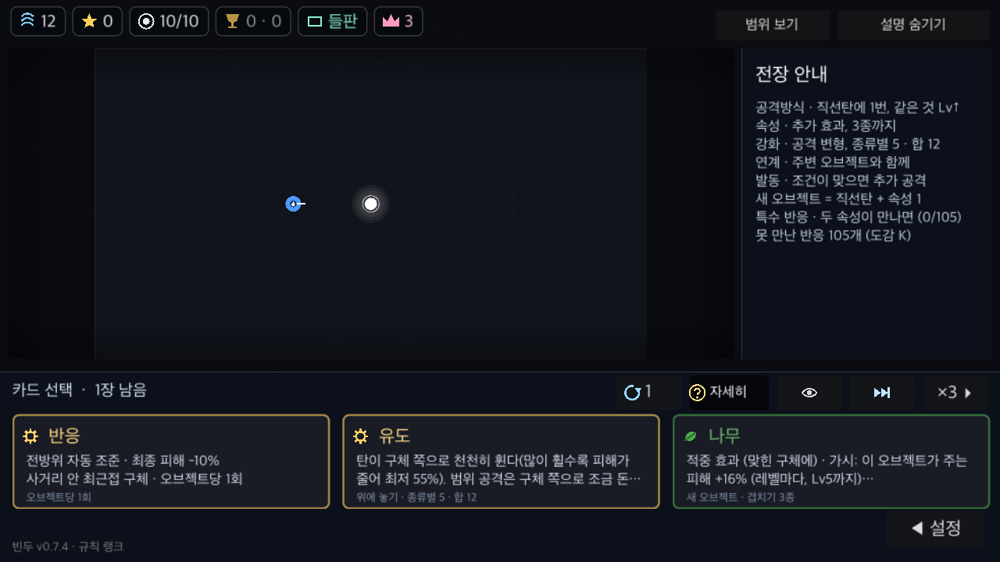
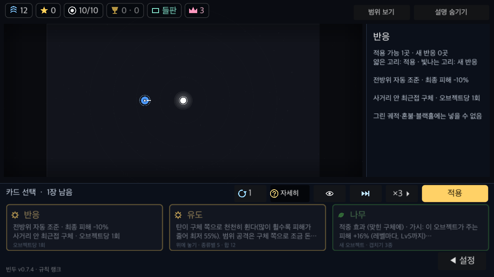
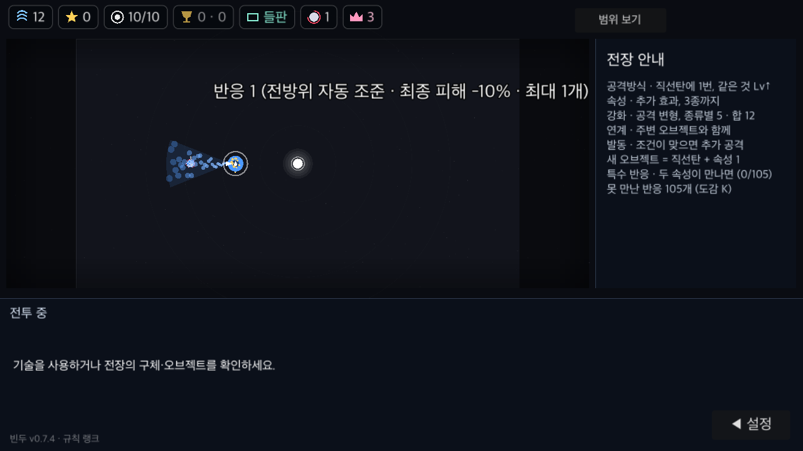

# PR #11 리뷰 및 수정 검증

검토 일자: 2026-11-03. 최초 검토 head: `3e95d7d46f21e5b56461c61ff311625ca82942ee`, base: `a1687c9baca060c897fad849a11406e721dc026e`.

## 발견 사항 — 모두 수정

| 우선순위 | 확신 | 최초 head의 경로·줄 | 재현 근거 | 수정 후 |
|---|---|---|---|---|
| P2 | 높음 | `scripts/tower.gd:1482-1484` | 대상이 없을 때 모든 `cd`를 줄인 뒤 `_reactions`에서 반응 쿨다운을 다시 줄임. 0.1초 진행 시 1초 쿨다운의 기대 잔여 0.9130, 실제 0.8261 | 별도 감소는 기본 공격 `p`에만 적용. 잔여 0.9130 |
| P2 | 높음 | `scripts/tower.gd:2058-2064` | 바람 Lv3·크기 5·유도 1 조건에서 투척 감지/실제 탄 사거리 420/571.2, 돌풍 672/571.2, 관통 연사·철구·파편탄 900/1224.0 | 실제 탄의 바람 보정 반영. 돌풍에 잘못 곱한 크기 배율 제거. 다섯 공격 모두 실제 이동거리와 일치. 추가로 폭풍의 순풍/역풍 감지 누락도 재현 후 방향별 이동거리로 수정 |
| P2 | 높음 | `scripts/tower.gd:2062` | 두 번째 벽은 150에 서지만 감지 사거리는 118이라 그 위치의 구체를 아예 찾지 못함 | 모든 벽 슬롯 중 가장 먼 거리와 벽 반지름 사용. 기본 감지 178, 거리 150 감지 성공 |
| P2 | 높음 | `scripts/rx_more.gd:511` | `처형 낫`은 체력 20% 아래 일반 구체를 바로 처치해야 하지만 남은 체력까지 0.9배로 깎음. max_hp=1000, hp=100 재현에서 hp=9.817로 생존 | 조건부 즉사에는 피해 감산을 재적용하지 않음. 같은 재현에서 hp=-0.010으로 처치 |

이 네 항목을 `tools/spec_check.gd`의 `_reflex_review_regressions()`로 먼저 추가했습니다. 수정 전 네 항목 모두 실패했으며, 쿨다운 → 사거리·벽 → 처형 순으로 수정하고 각 단계의 같은 검사로 재확인했습니다. 폭풍의 순풍/역풍 경계를 추가한 다섯 검사 모두 최종 통과합니다. 기존 검사는 기본 적중·조준 방향 위주라 위 경계를 잡지 못했습니다. 폭풍 항목은 처음 네 문제를 수정한 후 맵 보정 경로를 추가 점검하면서 발견했습니다.

## 두 가지 검토 결과

- **정확성·위험:** 위 네 결함 수정. 중복 선택·저장 복원·기본 공격 조준·피해 출처 전달·효과 없는 공격 조합 거절도 읽고 기존/신규 자동 검사로 확인했습니다. 추가로 확정한 코드 결함은 없습니다.
- **요구사항:** 이 채팅의 원 요청(반응 카드, 1회 선택, 방향 고정 해제, 최종 피해 -10%)과 `docs/features.md`의 `MOD-13`, PR 본문의 플레이 규칙을 기준으로 검토했습니다. 오브젝트별 1회·최근접 조준·기존 무효 조합 제외라는 구현 해석을 유지합니다. 처형의 일반 적중 피해는 감소하지만 조건부 즉사는 기존 카드 설명대로 유지하도록 명세를 명확히 했습니다.

루트 `REVIEW.md`가 없어 P0/P1 차단 기준은 실행 불가·크래시·데이터 손실·핵심 기능 불능으로 잡았습니다. 발견 항목은 특정 조합의 기능 오류인 P2로 분류했습니다. 배포 판정에는 루트 `CLAUDE.md`의 전체 `check` 통과 조건을 따릅니다.

## 검증 결과

- `GODOT=<Godot 4.7.2> tools/run.sh check`: **전체 실패 — 기존 rulekeys 오류**.
- 개별 통과: spec 176개 기능(실패 0), 그린 궤적, fuzz 4판(각 스크립트 오류 0), 13웨이브 이어하기, 온라인 서명, patch keys, 정원 검사, 패치노트 검사.
- 서버 pytest: 실행 환경에 fastapi·pytest·httpx가 없어 기존 검사 도구가 건너뜀.
- `git diff --check`: 통과.
- native macOS OpenGL, 1280×720에서 글자 1.3·터치 UI와 글자 1.0·마우스 UI로 카드 앞면·상세·후방 공격을 렌더링했습니다. 폭풍 맵의 범위 미리보기 경로도 별도로 렌더링했습니다. 각 3개 화면에 `UI ok`, `REFLEXSHOT fails=0` 확인. 실제 전투 처리에서 고정 방향 RIGHT를 유지한 오브젝트가 LEFT를 조준하고 후방 구체 체력을 감소시키는 것도 도구가 확인합니다.
- 아래 PNG는 실제 Godot 화면입니다. 생성 도구: `tools/reflex_shot.gd`. 저장 공간 보호를 위해 `BinduTools*` 이름의 임시 사본에서만 실행되며, 온라인 서버 주소를 비운 사본을 사용했습니다.

### 카드 앞면 — 핵심 수치가 말줄임 없이 보임

### 상세 설명 — 선택 제한과 제외 조합

### 실제 후방 공격 — 원래 고정 방향은 오른쪽

## 확인 완료 및 남은 한계

**확인 완료:** PR의 변경 파일 전부, 원 요청과 기능 명세, 선택 제한·조준·피해 감산·저장 경로, 네 회귀 재현의 수정 전/후, 위 자동 검사와 macOS 렌더링. 구현자 본인의 재검토이며 별도 독립 리뷰어 검토는 없습니다. 스크린샷 도구 종료 시 ObjectDB 인스턴스 2개 경고가 관찰됐으며, 실제 플레이의 메모리 누수 여부는 이 검사로 판단하지 않습니다.

**평가하지 못한 범위:** 모바일 실기기 입력·프레임 성능, 실제 멀티 세션, 서버 pytest, 배포된 빌드. 렌더링의 touch 설정은 모바일 실기기 증거가 아닙니다. 미배포 기능이므로 배포 동작으로 주장하지 않습니다.

**최종 배포 판정: `no_ship` — 확신 높음.** 이번 수정의 기능 검사는 통과했지만 전체 `check`는 기존 `server/app/rule_keys.json`의 진입 시간 수치 4개 누락으로 실패합니다. 이 PR과 무관한 목록 변경은 포함하지 않았습니다. 병합·배포 승인으로 해석하지 않습니다.
